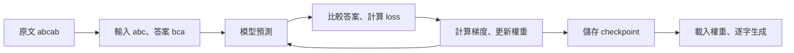
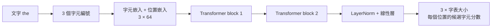

# my-gpt

這個專案帶你用 C# 和 ILGPU，從一次加法建立到能接續文字的小型 GPT，並在 NVIDIA GeForce GTX 1650 with Max-Q Design（4 GB）上執行訓練與推論。預期讀者具備基本 C# 陣列、迴圈與函式概念，課程會逐步引入梯度、矩陣和注意力。

**本專案主要由 GPT 透過 Codex 執行開發。** 程式實作、教學文件、訓練操作及驗證主要由 GPT 完成，使用者提供需求、硬體條件與回饋。開發期間另由子代理分別審查教學可理解性、GPU 數學與執行重現性。

目前的模型使用簡單英文句型訓練。輸入 `the fox ` 後，它會逐字接續文字。互動介面每次接受一段獨立開頭，輸入需使用訓練字表內的字元。

## 先理解最後要完成的事

把原文 `abcab` 錯開一格，可以得到輸入 `abc` 和答案 `bca`。第一個位置看到 a，要猜 b。第二個位置看到 ab，要猜 c。第三個位置看到 abc，要猜 a。這就是整個專案反覆使用的「預測下一個字元」。

訓練時，模型先預測，再和已知答案比較，用誤差調整權重。權重是模型可以學習的數字，例如把輸入轉成候選字元分數的乘數。生成時，程式讀回學好的權重，挑出下一個字元接回開頭，再預測下一個。你會在第 1 課第一次調整權重，第 5 課訓練完整模型，第 6 課把它做成能連續操作的命令列。



loss 是模型這次預測的錯誤程度，梯度描述調整某個權重會如何影響 loss。前幾課會用能手算的數字把這兩件事拆開說明。

## 七堂課怎麼接起來

每課只增加一個主要問題。第 0、1 課各有獨立的小專案，讓你能用少量數字驗算。第 2 課開始，所有命令共用 `lessons/miniGPT` 裡的完整實作，依序觀察其中的運算、組裝、訓練與生成。

### 第 0 課　讓 C# 把工作交給 GPU

先計算 `[1,2] + [3,4] = [4,6]`。你會看到資料如何從主記憶體複製到顯卡，由 GPU 函式（kernel）依索引處理，再把答案帶回來。這建立後續所有 GPU 運算需要的裝置選取、記憶體與同步概念。

完成後，應能解釋 index=1 為什麼得到 6，以及程式如何確認答案。下一課先回到小型 CPU 範例，集中理解「數字如何透過更新而學習」，再把學習所需的運算帶回 GPU。[第 0 課教材](lessons/00-cuda/README.md)

### 第 1 課　從加法走到會學習的數字

沿用上一課的陣列與逐項計算觀念，加入可調整的權重。輸入 2、目標 4，權重從 1 改成 1.4 後，loss 從 2 降到 0.72。接著用 `abcab` 訓練 bigram，為目前字元的三個下一字元候選打分數，用 softmax 轉成機率。

完成後，應能說出權重為什麼往那個方向移動，以及 a→b、b→c、c→a 怎麼從原文產生。bigram 為每個字元保存一列候選分數。要讓向量輸入同時算出多個候選分數，下一課需要矩陣乘法。[第 1 課教材](lessons/01-learning/README.md)

### 第 2 課　一次算出多個候選字的分數

把第 1 課的「輸入乘上權重」擴大成矩陣乘法。每列代表一個輸入位置，每欄代表一個候選輸出。用手算出 `[4,6,10,12]`，再執行 `math`，核對第 0 課的 GPU 是否也算出相同結果。

這個小例子先核對乘法本身。同樣的運算放到模型最後一層時，每一欄會對應一個候選字元，它的分數稱為 logit。分數經 softmax 變成機率後，就能用正確字元的機率計算交叉熵 loss。完成後，應能把一列數字追到一列預測分數。下一課會用同樣的矩陣乘法，讓各位置從前文讀取資訊。[第 2 課教材](lessons/miniGPT/README.md#lesson-2)

### 第 3 課　讓預測參考前面的字

第 1 課的 bigram 只依目前字元預測。例如 `the ` 和 `in the ` 最後都是空白，卻需要不同的前文資訊。這一課先把每個字元與位置轉成向量，再用第 2 課的乘法計算 Q、K、V。Q 和 K 的分數決定每個位置要從哪些 V 讀取資訊，這個過程就是注意力。

執行 `attention`，觀察 abc 的三列注意力機率。未來位置的權重必須為零，讓模型做題時只能讀取已出現的文字。再沿著 LayerNorm、注意力、殘差相加、前饋網路讀完一個 Transformer block。完成後，應能說明一個位置如何取得前文資訊。下一課要確認這些計算及梯度都正確。[第 3 課教材](lessons/miniGPT/README.md#lesson-3)

### 第 4 課　確認模型的計算和學習方向

把前幾課的手算擴大為獨立的 CPU 參考答案。執行 `check`，比較 CPU 和 GPU 的預測分數，再從每組參數抽一個元素，各加減一點，從 loss 的變化估計梯度。它也會檢查未來字元的改動、不同 batch 的隔離，以及存檔再載入的結果。

完成後，應能解釋為什麼梯度值得相信，以及固定一小批資料為什麼可以被模型記住。有了這些依據，下一課才把完整訓練迴圈接到真正的語料。[第 4 課教材](lessons/miniGPT/README.md#lesson-4)

### 第 5 課　把小例子擴大成完整訓練

把第 1 課的更新方式、第 3 課的模型、第 4 課的數值檢查串在一起。程式從文本抽取一段輸入，答案是原文的下一字元。在 GPU 上預測、計算 loss、反向傳播，再由 AdamW 更新權重。反覆做完一次批次更新，就是一個 step。

這一課把資料分為訓練段與驗證段，觀察模型對保留文字的預測，並將權重、動量和步數存進 checkpoint。完成後，應能訓練、關閉程式、還原並繼續更新。下一課會用已學好的權重處理新開頭。[第 5 課教材](lessons/miniGPT/README.md#lesson-5)

### 第 6 課　把下一字元預測變成可操作的生成

載入第 5 課的 checkpoint，輸入 `the fox `，選出下一個字元，接回文字後再預測。這樣重複就得到整句續寫。互動命令列讓同一份權重留在 GPU 中，可連續接受不同開頭。

完成後，應能用 `chat` 續寫、用 `benchmark` 對照固定開頭、用 `score` 評分指定文本，也能解釋為什麼生成時會使用最近 64 個字元。這時，從第 0 課的 GPU 陣列運算到可使用的模型就接起來了。[第 6 課教材](lessons/miniGPT/README.md#lesson-6)

## 把課程對應到實際架構

### 先看模型內部如何把字變成分數

以完整模型處理 `the` 為例，三個字元編號各查出 64 個數字，得到「3 個有效位置 × 64 個數字」的陣列。位置嵌入會讓模型分辨各字出現在第幾格。之後兩個 Transformer block 依序讀取、混合前文資訊，最後為每個位置產生「字表大小」個分數。



圖中只畫有文字的前三格。實際推論會把輸入補到固定的 64 個位置，嵌入陣列為 64 × 64，輸出為 64 × 字表大小。輸入 `the` 時，程式讀取第 3 列的分數來選下一字元。因果遮罩讓這一列不受後方填補位置影響。

每個 block 的內部順序是 LayerNorm → 多頭因果注意力 → 殘差相加 → LayerNorm → 前饋網路 → 殘差相加。LayerNorm 調整每列的數值尺度，前饋網路先把寬度從 64 擴成 256，經過 GELU 非線性函式再縮回 64。殘差把輸入加回結果，讓資訊與梯度能繼續流動。這正是第 2 課的乘法和第 3 課的注意力組合起來的模型。

### 再看誰負責呼叫這些運算

| 你要做的事 | 呼叫順序 | 各段負責什麼 |
|---|---|---|
| 反覆輸入開頭 | `Program` → `InteractiveCli` → `InferenceSession` | 分派命令、讀取輸入、編碼並逐字生成 |
| 一次生成或評分 | `Program` → `InferenceCommands` → `InferenceSession` | 解析參數、執行生成或評分、列印結果 |
| 訓練與續訓 | `Program` → `Model.Train` | 準備資料視窗、求 loss、反向傳播、更新權重 |
| 做數學檢查 | `Program` → `Checks` → `Model` 與 `Reference` | 對照 GPU 結果與獨立 CPU 答案 |

這些名字都對應到同名的 C# 檔案。這裡的張量是保存在 GPU 上的數字陣列。`Model.cs` 把張量接成運算圖，像是先把某一層的輸出送去注意力，再送去前饋網路。`Kernels.cs` 則執行每一個運算的具體數學。第 0 課只有一個加法 kernel，完整 GPT 會依序呼叫矩陣乘法、正規化、注意力和更新等 kernel。

C# 主程式在 CPU 上負責命令、文字編碼、抽取資料與讀寫檔案。模型的前向、反向與 AdamW 更新透過 ILGPU 在 CUDA 顯卡上執行。`Reference.cs` 的小矩陣 CPU 實作提供第 4 課的獨立答案。

### 追蹤一次訓練與一次生成

訓練從 `Program.cs` 讀取 UTF-8 文本開始。程式統一換行，依原順序約九成訓練、一成驗證，條件允許時切在換行後，再抽取輸入與下一字元答案。`Model.Evaluate` 產生 logits 並計算交叉熵。`Differentiate` 反向走過計算圖累加梯度。AdamW 更新權重。AdamW 會保留近期梯度的平均與平方平均，據此調整各權重的更新步幅，這兩份狀態也會保存供續訓使用。只有訓練資料會用來更新權重。

生成先由 `InferenceSession` 呼叫 `Checkpoint.Load` 載入模型，使用 batch 1，省去梯度與動量的 GPU 配置。接著才接受開頭文字，呼叫 `Model.Forward` 算到 logits 後回傳，選取最大分數的字元並接回開頭，再進行下一次預測。相同模型與開頭會得到相同的貪婪續寫結果。

兩條路徑共用模型的前向數學。`Checkpoint.cs` 讓第 5 課更新出的權重能在第 6 課重新使用，並保存續訓需要的步數、字表與動量。存檔先寫暫存檔，再替換目標檔。視窗依模型步數決定，搭配相同語料、動量及學習率，可重現續訓。

| 完整模型設定 | 預設值 |
|---|---|
| 精度 | FP32 |
| Transformer 層數 | 2 |
| 嵌入寬度 | 64 |
| 注意力頭數 | 4，每個頭寬度 16 |
| 前饋網路寬度 | 256 |
| 上下文長度 | 64 個字元 |
| 新模型訓練 batch | 預設 1，可指定 1 至 4 |
| 推論 batch | 1 |
| 優化器與預設學習率 | AdamW、0.003，可用 `--lr` 調整 |

第 3 課的觀察範例使用較小的 1 層、2 個頭、嵌入寬度 8，方便印出注意力表。第 4 課也用小尺寸檢查數學。第 5 課才使用上表的完整預設模型。字表是從訓練文字建立的，因此 `abc` 是示意資料，內建英文語料會得到自己的字表。

## 實際執行前的準備

需要 Windows、可用的 NVIDIA 驅動、支援 `net10.0` 的 .NET SDK 與 .NET 10 runtime。執行 `nvidia-smi`、`dotnet --list-sdks`、`dotnet --list-runtimes` 可確認環境。第一次建置需從 NuGet 取得 ILGPU 1.5.3 套件，或已有套件快取。[.NET 10 下載](https://dotnet.microsoft.com/download/dotnet/10.0)

所有命令都從專案根目錄執行。第 0、1 課由各自的專案啟動，第 2 課開始可使用 `.\minigpt.cmd`：

```powershell
dotnet run --project lessons/00-cuda/Lesson00.csproj
dotnet run --project lessons/01-learning/Learning.csproj
.\minigpt.cmd math
.\minigpt.cmd attention
.\minigpt.cmd check
```

### 已有模型時啟動互動模式

```powershell
.\minigpt.cmd
```

程式從 `lessons/miniGPT` 載入唯一的 checkpoint。輸入 `the fox ` 後按 Enter，即可看到逐字新增的文字。

| 互動指令 | 用途 |
|---|---|
| `/length 60` | 每次新增 60 個字元，預設 100 |
| `/info` | 顯示步數、CUDA 裝置與字表 |
| `/help` | 操作說明 |
| `/exit` | 結束並釋放 GPU 資源 |

有多份模型時，用 `chat` 指定檔案。相對路徑以目前工作目錄為準。

```powershell
.\minigpt.cmd chat "lessons/miniGPT/quality-step1001-lr0.0003-22f75508d3.ckpt"
```

### 首次下載時建立模型

checkpoint 由根目錄 `.gitignore` 排除，保存在訓練電腦。可以複製既有權重，或先建立一份練習模型：

```powershell
.\minigpt.cmd train lessons/miniGPT/quickstart.ckpt 100
.\minigpt.cmd
```

100 步用來觀察訓練流程，生成品質需搭配驗證與實際續寫判斷。第 5 課會進一步解釋如何保存、比較與續訓。指定新檔名時，該檔案需尚未存在。

## 每個檔案的用途

下表包含清理後的原始碼、教材、設定及本機模型。檔名皆相對於專案根目錄。

| 檔案 | 用途與使用者 |
|---|---|
| `README.md` | 專案入口、架構、操作與完整檔案清單 |
| `minigpt.cmd` | Windows 啟動腳本，定位 miniGPT 專案並轉交參數 |
| `.gitignore` | 專案共用忽略規則，排除建置輸出、IDE 狀態、checkpoint、環境變數與憑證 |
| `lessons/00-cuda/Lesson00.csproj` | 第 0 課 .NET 專案，引用 ILGPU |
| `lessons/00-cuda/Program.cs` | CUDA 裝置選取、向量加法與 CPU 驗算 |
| `lessons/00-cuda/README.md` | 第 0 課操作、手算與改數字練習 |
| `lessons/01-learning/Learning.csproj` | 第 1 課獨立 .NET 專案 |
| `lessons/01-learning/Program.cs` | 單一權重更新與 bigram 下一字元訓練 |
| `lessons/01-learning/README.md` | 第 1 課梯度算式、預期結果與練習 |
| `lessons/miniGPT/MiniGPT.csproj` | 建置入口，引用 ILGPU.Algorithms，將語料複製到執行目錄 |
| `lessons/miniGPT/Program.cs` | 命令入口、訓練迴圈、驗證切分及訓練後樣本生成 |
| `lessons/miniGPT/InteractiveCli.cs` | 互動輸入、模型選取、斜線指令與逐字顯示 |
| `lessons/miniGPT/InferenceCommands.cs` | 單次生成、固定提示詞評估、文本評分及顯示結果 |
| `lessons/miniGPT/InferenceSession.cs` | 重用已載入模型，負責編碼、滑動視窗生成與評分 |
| `lessons/miniGPT/Model.cs` | GPU 記憶體、Transformer 計算圖、前向、反向與參數更新 |
| `lessons/miniGPT/Kernels.cs` | ILGPU 核心函式，計算前向數學、梯度與 AdamW 更新 |
| `lessons/miniGPT/Checkpoint.cs` | 讀寫自訂 MiniGPT/1 格式，推論與續訓共用 |
| `lessons/miniGPT/Checks.cs` | 數值、梯度、因果遮罩、批次、推論及存檔還原檢查 |
| `lessons/miniGPT/Reference.cs` | C# double 與二維陣列的獨立 CPU 答案，供 Checks 對照 GPU |
| `lessons/miniGPT/corpus.txt` | 預設英文語料，64 個不同句型組合，依程式切分為訓練與驗證資料 |
| `lessons/miniGPT/README.md` | 第 2 至 6 課的矩陣、注意力、驗收、訓練與推論教材 |
| `lessons/miniGPT/quality-step1001-lr0.0003-22f75508d3.ckpt` | 本機最佳模型，供生成、評分與續訓載入 |

`Checks.cs` 與 `Reference.cs` 提供教學驗收所需的獨立答案。第 0、1 課保留從基礎理解 GPT 的學習順序，各自可單獨執行。

## 權重檔保存了什麼

本機最佳 checkpoint 的步數為 1001、訓練 batch 為 4，最後一段續訓學習率為 0.0003，當時驗證 loss 為 0.0786。這個值來自已多次用來調參的教材驗證資料。

`.ckpt` 保存格式版本、模型尺寸、步數、字表、語料 SHA-256，以及每組參數的權重和 AdamW 兩組動量。生成時提供權重與開頭即可，續訓還需相同語料。

目前語料為簡單英文。新模型的字表支援 2 至 1024 個單一 UTF-16 單元的字元，含 emoji 或其他代理對的文本會提示錯誤。訓練與驗證段各需至少 65 字元，驗證字元需已在訓練段出現。

## 常用命令

以下命令從專案根目錄執行。`minigpt.cmd` 可轉交所有 miniGPT 指令。

```powershell
$model = "lessons/miniGPT/quality-step1001-lr0.0003-22f75508d3.ckpt"
if (-not (Test-Path -LiteralPath $model)) {
    $model = "lessons/miniGPT/my-first.ckpt"
    if (-not (Test-Path -LiteralPath $model)) {
        $model = "lessons/miniGPT/quickstart.ckpt"
    }
}

# 單次續寫 60 個字元
.\minigpt.cmd generate $model "the fox " 60

# 固定四個開頭，各續寫 100 個字元
.\minigpt.cmd benchmark $model 100

# 評分指定文本
.\minigpt.cmd score $model lessons/miniGPT/corpus.txt

# 從頭訓練另一份模型
.\minigpt.cmd train lessons/miniGPT/new-batch4.ckpt 500 lessons/miniGPT/corpus.txt 4

# 在副本上續訓
$trial = Join-Path $PWD.Path "lessons/miniGPT/trial.ckpt"
[IO.File]::Copy((Resolve-Path -LiteralPath $model).Path, $trial)
.\minigpt.cmd resume lessons/miniGPT/trial.ckpt 100 --lr 0.0001

# 數學與重現性檢查
.\minigpt.cmd check
.\minigpt.cmd math
.\minigpt.cmd attention
```

新模型與副本檔名需尚未存在。新增 checkpoint 後，互動模式可用 `chat` 指定模型。

`benchmark` 使用教材英文開頭，回報載入時間、暖機後首字等待時間、生成字元／秒、完整句與重複句數。`score` 回報 loss、字元 perplexity 與下一字元正確率。`corpus.txt` 包含訓練內容，評估泛化能力時應在下一輪訓練前保留獨立測試集，完成調參後再評分。

## 產生檔與清理方式

| 路徑或類型 | 用途與處理 |
|---|---|
| 各專案 `bin/` | 建置後的 EXE、DLL、PDB、執行設定與複製的語料，可由 dotnet run 重建 |
| 各專案 `obj/` | NuGet 還原資訊、編譯快取與中間輸出，可由建置重建 |
| 各專案 `.vs/` | Visual Studio 索引、工作區與個人 IDE 狀態，IDE 會重新建立 |
| 訓練期間 `*.lock` | 防止同時寫入同一模型，正常退出時自動刪除 |
| 存檔期間 `*.tmp` | checkpoint 替換前的暫存檔，正常存檔後清除 |
| `.git/` | Git 歷史與版本控制資料，由 Git 管理 |

本次清理移除了三個專案的 `bin/`、`obj/` 與 `.vs/`。下次建置與使用 IDE 時會再產生。最佳 checkpoint 是訓練成果，應另行備份。

## 參考來源

模型與教學方向參考 [Karpathy 的 minGPT](https://github.com/karpathy/minGPT)。GPU 部分使用 [ILGPU](https://ilgpu.net/docs/)，以 C# 實作計算圖與核心函式。教材基礎對應 [LLM Training by Zach 播放清單](https://www.youtube.com/playlist?list=PLRYer4Da-4mIj5AYQczxpFepL_03080UT) 前四部的神經網路、預訓練、張量與 Transformer 概念。
