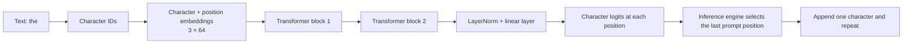

# my-gpt

**繁體中文：** [閱讀繁體中文版](README.zh-TW.md). English lesson and function walkthroughs: [Lesson 0](lessons/00-cuda/README.md), [Lesson 1](lessons/01-learning/README.md), [Lessons 2–6](lessons/my-gpt/README.md), [application functions](docs/functions.en.md), and [model functions](docs/model-functions.en.md).

This project teaches how to build a small character-level GPT in C# with ILGPU. It starts with GPU vector addition and gradually adds learning, matrix operations, attention, checks, training, and text generation. The complete model can be trained and run on an NVIDIA GeForce GTX 1650 with Max-Q Design (4 GB).

**GPT was the primary developer of this project, working through Codex.** GPT mainly implemented the code, lessons, training operations, and verification. The user provided requirements, hardware constraints, and feedback. Subagents reviewed lesson clarity, GPU mathematics, and reproducibility during development.

The model learns simple English sentence patterns from a small corpus. For example, give it `the fox ` and it will continue one character at a time. The vocabulary is built from the training text, so prompts must use characters present in that vocabulary.

## What is my-gpt?

GPT means **Generative Pre-trained Transformer**. This project predicts the next character from the characters that came before it. A character is one token, or one input unit, in this implementation. Attention lets the Transformer use earlier context. Training adjusts numerical parameters, called **weights**, to capture patterns from examples. During generation, the model assigns a score called a **logit** to each possible next character.

Karpathy's [minGPT](https://github.com/karpathy/minGPT) is an educational GPT implementation written in PyTorch. This project follows its teaching-oriented ideas while implementing a small character-level GPT in C# and ILGPU.

The phrase **my-gpt model** means the Transformer computation rules together with the trained weights. `Model.cs` assembles the computation, `Kernels.cs` implements its GPU mathematics, and a `.ckpt` checkpoint stores weights, vocabulary, dimensions, step count, and training state.

An **inference engine** is the program that uses a trained model to answer a request. In this project, `InferenceSession.cs` loads a checkpoint, encodes text as token IDs, prepares context, calls the model's forward pass, chooses a character, and repeats the process. `Checkpoint.Load` reads the model; `Model.Forward` and `Kernels.Forward` perform the computation on the GPU. The engine turns one next-character prediction into a full continuation.

| | Model | Inference engine |
|---|---|---|
| Main job | Give scores to possible next characters | Load and run the model to generate or score text |
| Main code | `Model.cs`, `Kernels.cs`, and checkpoint weights | `InferenceSession.cs`, plus the CLI and checkpoint loader |
| During generation | Uses fixed trained weights to calculate logits | Encodes text, manages context, selects characters, and loops |
| During training | `Model.Train` and AdamW update the weights | Not used to update weights |

`InteractiveCli.cs` provides a persistent interactive prompt. `InferenceCommands.cs` handles one-shot commands. Both use the same inference session and model forward pass. The training and inference paths share the forward mathematics; inference loads the weights without allocating gradients or optimizer state.

## Learning path

Each lesson adds one main idea. Lessons 0 and 1 are small, separate projects so you can inspect and check a few values. Lessons 2–6 use the complete implementation under `lessons/my-gpt`.

| Lesson | What you learn | How it connects to the next lesson |
|---|---|---|
| 0. Send work to the GPU | Copy `[1,2]` and `[3,4]` to the GPU, add them in an ILGPU kernel, and check `[4,6]` on the CPU. | Establishes device, memory, kernel, and synchronization concepts. Lesson 1 then explores learning with tiny CPU examples. [Lesson 0 guide](lessons/00-cuda/README.zh-TW.md) |
| 1. Make a number learn | Adjust one weight to reduce loss, then train a bigram model to predict the next character. | Shows how examples become scores and how weights change. Lesson 2 expands input-times-weight into matrix multiplication. [Lesson 1 guide](lessons/01-learning/README.zh-TW.md) |
| 2. Score candidates with matrices | Run `math` and follow a matrix multiplication that produces logits for possible next characters. | Establishes the operation used by attention. [Lesson 2 guide](lessons/my-gpt/README.zh-TW.md#lesson-2) |
| 3. Let predictions use earlier context | Run `attention`, inspect causal attention, and follow a Transformer block: normalization, attention, residual connections, and a feed-forward network. | Shows how positions gather information from earlier text. Lesson 4 checks the calculations and gradients. [Lesson 3 guide](lessons/my-gpt/README.zh-TW.md#lesson-3) |
| 4. Check calculations and learning direction | Run `check` to compare GPU results against an independent CPU implementation and numerically inspect gradients, causality, batching, inference, and checkpoint restore. | Provides confidence in the math before connecting it to corpus training. [Lesson 4 guide](lessons/my-gpt/README.zh-TW.md#lesson-4) |
| 5. Train the complete model | Sample text windows, predict the next character, calculate loss, backpropagate, update with AdamW, validate, and save a checkpoint. | Connects the earlier building blocks into training. Lesson 6 uses the saved weights. [Lesson 5 guide](lessons/my-gpt/README.zh-TW.md#lesson-5) |
| 6. Generate text | Load a checkpoint, give a prompt such as `the fox `, choose the next character, and repeat. | Completes the path from GPU addition to an interactive model. [Lesson 6 guide](lessons/my-gpt/README.zh-TW.md#lesson-6) |

## Architecture at a glance

For the prompt `the`, the model encodes three characters as integer IDs. Character and position embeddings turn them into vectors. Two Transformer blocks process those vectors, and a final normalization and linear layer produces one row of character scores for each position.



The drawing shows three active positions. The implementation pads inputs to a fixed context of 64 characters, so the GPU arrays have 64 rows. A causal mask prevents a position from reading future positions or padding. The inference engine reads the logits for the last active prompt position.

The C# program runs on the CPU and handles commands, text encoding, training-window selection, and file access. ILGPU compiles and runs the model's forward pass, backward pass, and AdamW update on a CUDA device. The `Reference.cs` implementation runs a small independent calculation on the CPU for checks.

| Model setting | Default |
|---|---:|
| Numeric precision | FP32 |
| Transformer blocks | 2 |
| Embedding width | 64 |
| Attention heads | 4, width 16 each |
| Feed-forward width | 256 |
| Context length | 64 characters |
| Training batch | 1 by default; configurable from 1 to 4 |
| Inference batch | 1 |
| Optimizer | AdamW, default learning rate 0.003; `--lr` can override it |

The `attention` demonstration and `check` use smaller models to make results easier to inspect. Full corpus training uses the settings above.

## Requirements

- Windows and a working NVIDIA driver.
- .NET 10 SDK and runtime (`net10.0`).
- ILGPU 1.5.3, restored from NuGet or available in the local package cache.

Check the environment with `nvidia-smi`, `dotnet --list-sdks`, and `dotnet --list-runtimes`. The model selects a CUDA device; it does not fall back to a CPU model when CUDA is unavailable. See [.NET 10 downloads](https://dotnet.microsoft.com/download/dotnet/10.0).

## Run the project

Run every command below from the repository root in PowerShell. The first two commands run the standalone lessons; Lesson 2 onward uses `my-gpt.cmd`.

```powershell
dotnet run --project lessons/00-cuda/Lesson00.csproj
dotnet run --project lessons/01-learning/Learning.csproj
.\my-gpt.cmd math
.\my-gpt.cmd attention
.\my-gpt.cmd check
```

### Start interactive chat

The repository includes the best lesson checkpoint (step 1001, about 1.23 MiB). After cloning, start the interactive CLI:

```powershell
.\my-gpt.cmd
```

Type `the fox ` and press Enter. The program streams the continuation one character at a time. Enter `/exit` to quit and release GPU resources.

| Interactive command | Action |
|---|---|
| `/length 60` | Generate 60 new characters; default is 100 |
| `/info` | Show the step, CUDA device, and vocabulary |
| `/help` | Show interactive help |
| `/exit` | Quit |

To choose a specific checkpoint, run `.\my-gpt.cmd chat "lessons/my-gpt/quality-step1001-lr0.0003-22f75508d3.ckpt"`. Relative paths are resolved from the current working directory.

### Generate, benchmark, and score

These examples specify the checkpoint directly, so each command can be copied and run on its own:

```powershell
.\my-gpt.cmd generate "lessons/my-gpt/quality-step1001-lr0.0003-22f75508d3.ckpt" "the fox " 60
.\my-gpt.cmd benchmark "lessons/my-gpt/quality-step1001-lr0.0003-22f75508d3.ckpt" 100
.\my-gpt.cmd score "lessons/my-gpt/quality-step1001-lr0.0003-22f75508d3.ckpt" "lessons/my-gpt/corpus.txt"
```

`generate` appends the requested number of characters. `benchmark` runs fixed prompts and reports timing and simple output checks. `score` measures next-character loss and accuracy on the supplied text. A score on the training corpus is not a measure of generalization because the model has already seen that text.

### Create a local checkpoint

The best lesson checkpoint is included in Git. Other checkpoints produced during training are ignored. To train your own quick-start model, use a new filename:

```powershell
.\my-gpt.cmd train lessons/my-gpt/quickstart.ckpt 100
.\my-gpt.cmd chat lessons/my-gpt/quickstart.ckpt
```

The destination name must not already exist. One hundred steps demonstrate the training workflow; judge generation quality using validation and example prompts, not step count alone. Training accepts an optional corpus path and batch size. To continue from a checkpoint, use `resume` with an existing destination checkpoint. For example, `.\my-gpt.cmd train lessons/my-gpt/new-model.ckpt 500 lessons/my-gpt/corpus.txt 4` trains a new model with batch size 4. A learning-rate override is supplied as `--lr rate` for that command.

## Repository files

| Path | Purpose |
|---|---|
| `README.md` / `README.zh-TW.md` | English and Traditional Chinese project guides, architecture, usage, and file map |
| `my-gpt.cmd` | Windows launcher that locates the project relative to itself and forwards arguments |
| `.gitignore` | Excludes build outputs, IDE state, generated checkpoints (except the bundled best model), environment files, and credentials |
| `lessons/00-cuda/` | Standalone ILGPU vector-add lesson and its guide |
| `lessons/01-learning/` | Standalone weight-update and bigram lesson and its guide |
| `lessons/my-gpt/Program.cs` | Command dispatch, dataset preparation, training, and resume flow |
| `lessons/my-gpt/Model.cs` | Transformer layers, computation graph, forward pass, gradients, and training step |
| `lessons/my-gpt/Kernels.cs` | GPU forward and backward operations and AdamW updates |
| `lessons/my-gpt/Checkpoint.cs` | Atomic save, validation, loading, and optimizer-state restore |
| `lessons/my-gpt/InferenceSession.cs` | Text encoding, generation, text scoring, and session lifetime |
| `lessons/my-gpt/InteractiveCli.cs` | Persistent interactive chat commands |
| `lessons/my-gpt/InferenceCommands.cs` | One-shot `generate`, `benchmark`, and `score` commands |
| `lessons/my-gpt/Checks.cs` | GPU/CPU, gradient, causal, batch, checkpoint, and inference checks |
| `lessons/my-gpt/Reference.cs` | Independent CPU reference calculations |
| `lessons/my-gpt/corpus.txt` | Small English training and validation corpus |
| `docs/functions.zh-TW.md` | Function-by-function diagrams for commands, inference, checkpoints, and checks (Traditional Chinese) |
| `docs/model-functions.zh-TW.md` | Function-by-function diagrams for model assembly and GPU kernels (Traditional Chinese) |

The project and command use the name `my-gpt`. C# identifiers use the `MyGpt` namespace because hyphens are not allowed in C# identifiers. The checkpoint format supports the current `my-gpt/1` format and older checkpoints created before the rename.
