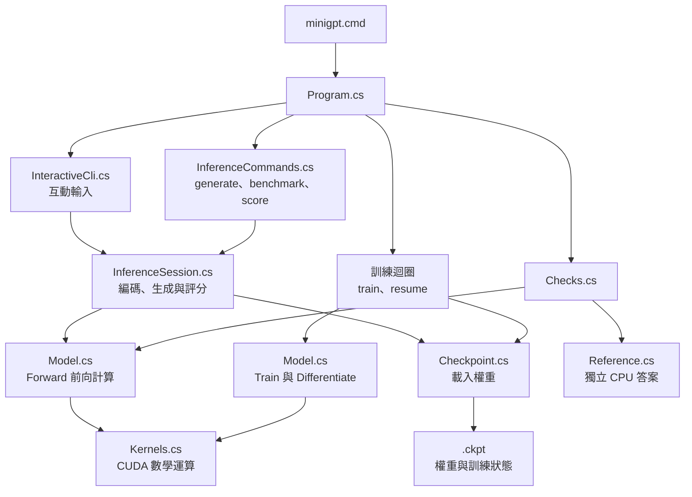

# my-gpt

這是一個用 C# 和 ILGPU 從零建立的字元級 GPT 教學專案。從 GPU 加法、手算梯度到完整 Transformer，每課都有可執行的入口。模型學習「根據前文預測下一個字元」，已在 NVIDIA GeForce GTX 1650 with Max-Q Design（4 GB）上完成訓練與推論。

目前保留的模型以簡單英文句型訓練，可接續 `the fox ` 等開頭。互動介面每次接受獨立的開頭，逐字顯示新增內容，輸入需使用模型字表內的字元。

## 開始使用

需要 Windows、可用的 NVIDIA 驅動、支援 `net10.0` 的 .NET SDK 與 .NET 10 runtime。執行 `nvidia-smi`、`dotnet --list-sdks`、`dotnet --list-runtimes` 可確認環境。初次建置需從 NuGet 取得 ILGPU 1.5.3 套件，或已有套件快取。[.NET 10 下載](https://dotnet.microsoft.com/download/dotnet/10.0)

### 這台電腦已有最佳權重

在 PowerShell 執行：

```powershell
# 在專案根目錄執行
.\minigpt.cmd
```

程式會從 `lessons/miniGPT` 載入唯一的 `.ckpt`。輸入 `the fox ` 並按 Enter，就會看到逐字續寫。結尾的空白也會傳給模型。

| 互動指令 | 用途 |
|---|---|
| `/length 60` | 每次新增 60 個字元，預設 100 |
| `/info` | 顯示模型步數、CUDA 裝置與字表 |
| `/help` | 操作說明 |
| `/exit` | 結束並釋放 GPU 資源 |

有多個 checkpoint 時，可明確指定模型。相對路徑以目前工作目錄為準。

```powershell
.\minigpt.cmd chat "lessons/miniGPT/quality-step1001-lr0.0003-22f75508d3.ckpt"
```

### 首次下載，需要先建立權重

checkpoint 儲存在訓練電腦，並由 `lessons/.gitignore` 排除。首次下載專案，可從原電腦複製權重到 `lessons/miniGPT`，或從專案根目錄執行：

```powershell
.\minigpt.cmd train lessons/miniGPT/quickstart.ckpt 100
.\minigpt.cmd
```

訓練會保存新權重。也能使用 `dotnet run --project lessons/miniGPT` 啟動互動模式。

## 整體架構

`minigpt.cmd` 把參數轉交給 `dotnet run`，由 `Program.cs` 選擇互動、單次推論、訓練或數學檢查。GPU 運算集中在 `Model.cs` 與 `Kernels.cs`。



### 模型資料流

1. 用字表把文字換成整數編號，例如 `abc` 可以表示成 `[0,1,2]`。
2. 查出字元嵌入向量，加上位置嵌入向量。
3. 通過兩層 Transformer。每層先做 LayerNorm 與多頭因果注意力，再做 LayerNorm 與前饋網路；兩段都有殘差相加。因果遮罩讓每個位置只能讀取當前與先前字元。
4. 最後的 LayerNorm 與線性層產生所有候選字元的分數，稱為 logits。
5. 生成時挑分數最高的字元接到文字後面，再預測下一個字元。超過上下文長度後，使用最近的一段文字。

| 設定 | 預設值 |
|---|---|
| 精度 | FP32 |
| Transformer 層數 | 2 |
| 嵌入寬度 | 64，每個字元用 64 個數字表示 |
| 注意力頭數 | 4，每個頭寬度為 16 |
| 前饋網路寬度 | 256 |
| 上下文長度 | 64 個字元 |
| 新模型訓練 batch | 預設 1，可由命令指定為 1 至 4 |
| 推論 batch | 1 |
| 優化器、預設學習率 | AdamW、0.003，可用 `--lr` 調整 |

`Model.cs` 定義模型設定、張量、參數與計算圖節點。`Kernels.cs` 用一維緩衝區與索引實作矩陣乘法、嵌入、LayerNorm、GELU、注意力、交叉熵及其梯度。模型計算使用 ILGPU CUDA accelerator；CPU 參考實作供 `check` 核對數學。

### 訓練路徑

`Program.cs` 讀取 UTF-8 語料並統一換行，依原順序約九成訓練、一成驗證，條件允許時切在換行後。每步從訓練段抽取視窗，原文為 `abcd` 時，輸入 `abc`，答案就是 `bcd`。

`Model.Evaluate` 前向計算交叉熵；`Differentiate` 反向走過計算圖並累加梯度；AdamW 更新權重與動量。視窗依模型步數決定，搭配已儲存的動量，可在相同語料及學習率下重現續訓。

`Checkpoint.Save` 先寫暫存檔，再替換目標檔。`resume` 讀回權重、步數與動量，並核對語料指紋。學習率由當次命令決定，使用自訂值時，每次續訓都需再次指定 `--lr`。

### 推論路徑

`InteractiveCli` 與 `InferenceCommands` 共用 `InferenceSession`。它載入一次權重後可依序接受多個要求；載入時跳過動量，使用 batch 1，省去梯度與動量的 GPU 配置。`Model.Forward` 計算至 logits，生成時逐字取最大值，互動介面透過回呼顯示新增字元。

`score` 用前向計算評估每個下一字元，每 64 個位置重置上下文，尾段也計入。訓練時的驗證只使用完整視窗，兩種 loss 的評分位置可能不同。生成使用最近 64 字元的滑動視窗。

## 每個檔案的用途

下表包含清理後的原始碼、教材、設定及本機模型。檔名皆相對於專案根目錄。

| 檔案 | 用途與使用者 |
|---|---|
| `README.md` | 專案入口、架構、操作與完整檔案清單 |
| `minigpt.cmd` | Windows 啟動腳本，定位 miniGPT 專案並轉交參數 |
| `lessons/.gitignore` | 排除建置目錄、IDE 狀態與本機 checkpoint |
| `lessons/00-cuda/Lesson00.csproj` | 第 0 課 .NET 專案，引用 ILGPU |
| `lessons/00-cuda/Program.cs` | CUDA 裝置選取、向量加法與 CPU 驗算 |
| `lessons/00-cuda/README.md` | 第 0 課操作、手算與改數字練習 |
| `lessons/01-learning/Learning.csproj` | 第 1 課獨立 .NET 專案 |
| `lessons/01-learning/Program.cs` | 單一權重更新與 bigram 下一字元訓練 |
| `lessons/01-learning/README.md` | 第 1 課梯度算式、預期結果與練習 |
| `lessons/miniGPT/MiniGPT.csproj` | 建置入口，引用 ILGPU.Algorithms，將語料複製到執行目錄 |
| `lessons/miniGPT/Program.cs` | 命令入口、訓練迴圈、驗證切分及訓練後樣本生成 |
| `lessons/miniGPT/InteractiveCli.cs` | 互動輸入、模型選取、斜線指令與逐字顯示 |
| `lessons/miniGPT/InferenceCommands.cs` | 單次生成、固定提示詞評估、文本評分及顯示結果 |
| `lessons/miniGPT/InferenceSession.cs` | 重用已載入模型，負責編碼、滑動視窗生成與評分 |
| `lessons/miniGPT/Model.cs` | GPU 記憶體、Transformer 計算圖、前向、反向與參數更新 |
| `lessons/miniGPT/Kernels.cs` | ILGPU 核心函式，計算前向數學、梯度與 AdamW 更新 |
| `lessons/miniGPT/Checkpoint.cs` | 讀寫自訂 MiniGPT/1 格式，推論與續訓共用 |
| `lessons/miniGPT/Checks.cs` | 數值、梯度、因果遮罩、批次、推論及存檔還原檢查 |
| `lessons/miniGPT/Reference.cs` | C# double 與二維陣列的獨立 CPU 答案，供 Checks 對照 GPU |
| `lessons/miniGPT/corpus.txt` | 預設英文語料，64 個不同句型組合，依程式切分為訓練與驗證資料 |
| `lessons/miniGPT/README.md` | 第 2 至 6 課的矩陣、注意力、驗收、訓練與推論教材 |
| `lessons/miniGPT/quality-step1001-lr0.0003-22f75508d3.ckpt` | 本機最佳模型，供生成、評分與續訓載入 |

`Checks.cs` 與 `Reference.cs` 提供教學驗收所需的獨立答案。第 0、1 課保留從基礎理解 GPT 的學習順序，各自可單獨執行。

## 權重檔保存了什麼

本機最佳 checkpoint 的步數為 1001、訓練 batch 為 4，最後一段續訓學習率為 0.0003，當時驗證 loss 為 0.0786。這個值來自已多次用來調參的教材驗證資料。

`.ckpt` 保存格式版本、模型尺寸、步數、字表、語料 SHA-256，以及每組參數的權重和 AdamW 兩組動量。生成時提供權重與開頭即可，續訓還需相同語料。

目前語料為簡單英文。新模型的字表支援 2 至 1024 個單一 UTF-16 單元的字元，含 emoji 或其他代理對的文本會提示錯誤。訓練與驗證段各需至少 65 字元，驗證字元需已在訓練段出現。

## 常用命令

以下命令從專案根目錄執行。`minigpt.cmd` 可轉交所有 miniGPT 指令。

```powershell
$model = "lessons/miniGPT/quality-step1001-lr0.0003-22f75508d3.ckpt"
if (-not (Test-Path -LiteralPath $model)) {
    $model = "lessons/miniGPT/quickstart.ckpt"
}

# 單次續寫 60 個字元
.\minigpt.cmd generate $model "the fox " 60

# 固定四個開頭，各續寫 100 個字元
.\minigpt.cmd benchmark $model 100

# 評分指定文本
.\minigpt.cmd score $model lessons/miniGPT/corpus.txt

# 從頭訓練另一份模型
.\minigpt.cmd train lessons/miniGPT/new-batch4.ckpt 500 lessons/miniGPT/corpus.txt 4

# 在副本上續訓
$trial = Join-Path $PWD.Path "lessons/miniGPT/trial.ckpt"
[IO.File]::Copy((Resolve-Path -LiteralPath $model).Path, $trial)
.\minigpt.cmd resume lessons/miniGPT/trial.ckpt 100 --lr 0.0001

# 數學與重現性檢查
.\minigpt.cmd check
.\minigpt.cmd math
.\minigpt.cmd attention
```

新模型與副本檔名需尚未存在。新增 checkpoint 後，互動模式可用 `chat` 指定模型。

`benchmark` 使用教材英文開頭，回報載入時間、暖機後首字等待時間、生成字元／秒、完整句與重複句數。`score` 回報 loss、字元 perplexity 與下一字元正確率。`corpus.txt` 包含訓練內容，評估泛化能力時應在下一輪訓練前保留獨立測試集，完成調參後再評分。

## 教材閱讀順序

| 課程 | 重點 | 說明 |
|---|---|---|
| 第 0 課 | GPU 裝置與第一個 kernel | [CUDA 加法](lessons/00-cuda/README.md) |
| 第 1 課 | 梯度下降、bigram | [一次更新如何學習](lessons/01-learning/README.md) |
| 第 2 至 6 課 | 矩陣、注意力、驗收、訓練與推論 | [miniGPT 實作教材](lessons/miniGPT/README.md) |

先看 miniGPT `Program.cs` 的入口，再沿互動或訓練路徑閱讀 `InferenceSession.cs`、`Model.cs` 和 `Kernels.cs`。需要核對公式時搭配 `Reference.cs` 的小矩陣實作。

## 產生檔與清理方式

| 路徑或類型 | 用途與處理 |
|---|---|
| 各專案 `bin/` | 建置後的 EXE、DLL、PDB、執行設定與複製的語料，可由 dotnet run 重建 |
| 各專案 `obj/` | NuGet 還原資訊、編譯快取與中間輸出，可由建置重建 |
| 各專案 `.vs/` | Visual Studio 索引、工作區與個人 IDE 狀態，IDE 會重新建立 |
| 訓練期間 `*.lock` | 防止同時寫入同一模型，正常退出時自動刪除 |
| 存檔期間 `*.tmp` | checkpoint 替換前的暫存檔，正常存檔後清除 |
| `.git/` | Git 歷史與版本控制資料，由 Git 管理 |

本次清理移除了三個專案的 `bin/`、`obj/` 與 `.vs/`。下次建置與使用 IDE 時會再產生。最佳 checkpoint 是訓練成果，應另行備份。

## 參考來源

模型與教學方向參考 [Karpathy 的 minGPT](https://github.com/karpathy/minGPT)。GPU 部分使用 [ILGPU](https://ilgpu.net/docs/)，以 C# 實作計算圖與核心函式。教材基礎對應 [LLM Training by Zach 播放清單](https://www.youtube.com/playlist?list=PLRYer4Da-4mIj5AYQczxpFepL_03080UT) 前四部的神經網路、預訓練、張量與 Transformer 概念。
