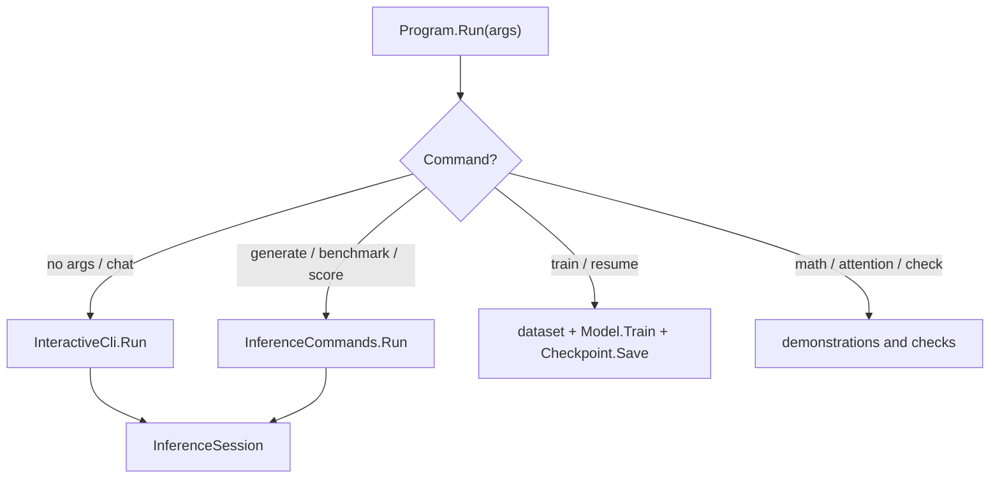
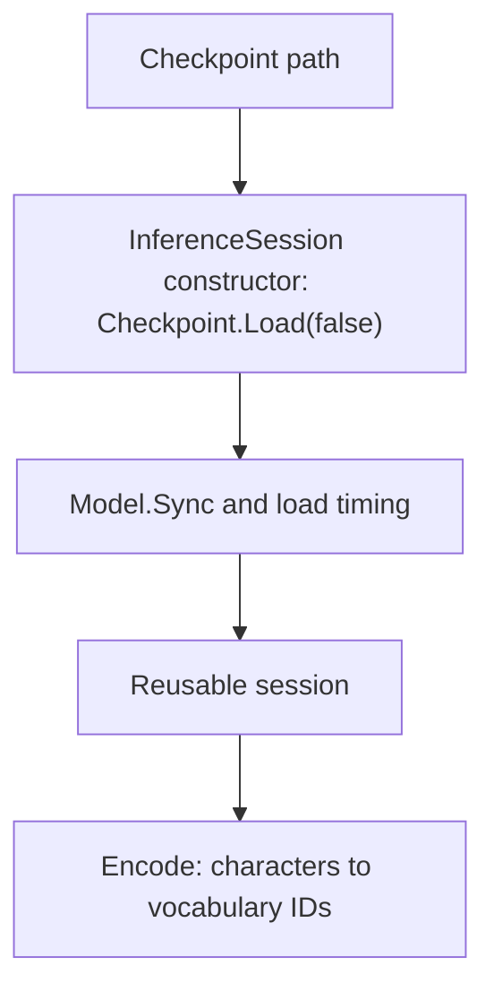
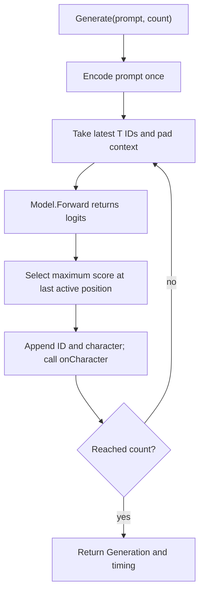
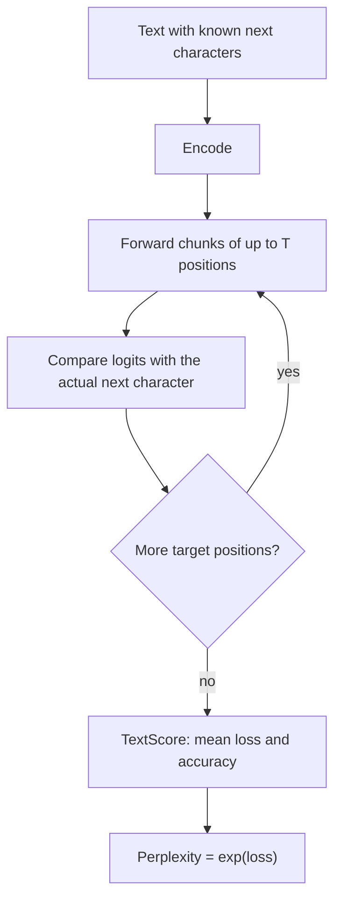
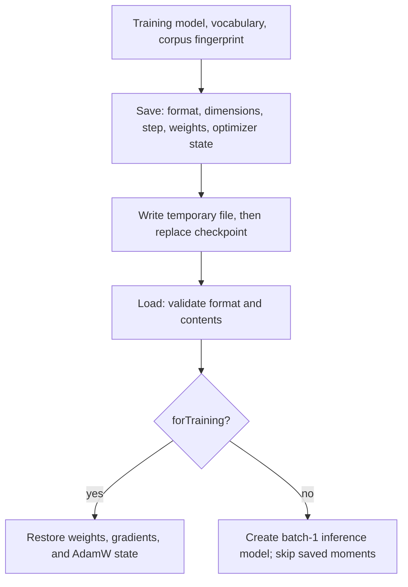
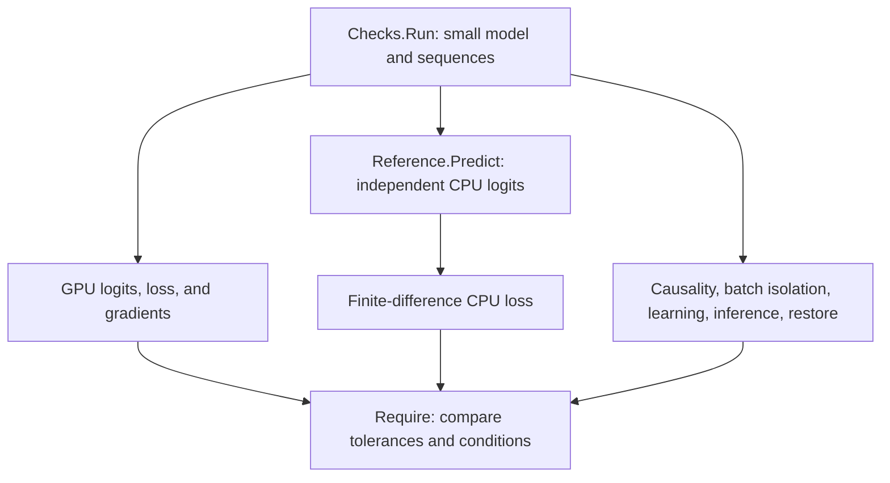

# Trace GPT Through the C# Functions

[Project overview](../README.md) · [Traditional Chinese](functions.zh-TW.md) · [Model, kernels, and CPU reference](model-functions.en.md)

Start with the prompt `the`. The program encodes its three characters as vocabulary IDs. The model calculates a row of candidate-character scores, called logits, at each position. To continue the prompt, the inference engine reads the third row, selects the highest-scoring character, appends it, and runs the model again. This guide follows that path from the command to the model.

## 1. Commands select the work

| Function | Input | What it does | Output or effect |
|---|---|---|---|
| `Program.Run` | Command-line arguments | Selects interactive chat, inference, training, or a demonstration | Runs the selected path; invalid arguments show usage |
| `InteractiveCli.Run` | Optional checkpoint path | Loads one session and reads prompts and slash commands until exit | Streams generated characters; disposes the session on exit |
| `InferenceCommands.Run` | `generate`, `benchmark`, or `score` arguments | Creates a session, performs the requested operation, prints results | Exit code 0, or an argument error |
| `InferenceCommands.Count` | Arguments and count position | Uses 100 when omitted; otherwise parses a non-negative integer | New-character count |

`benchmark` loads one session, warms it once, and reuses it for four fixed prompts. The command also times generation and counts matching and repeated complete corpus-style sentences. [CLI source](../lessons/my-gpt/InteractiveCli.cs) · [single-command source](../lessons/my-gpt/InferenceCommands.cs)

## 2. A session loads and encodes the checkpoint

| Function | Input | What it does | Output or effect |
|---|---|---|---|
| `InferenceSession` constructor | Checkpoint path | Loads an inference model and vocabulary, synchronizes, records load time | Session with device, step, and timing information |
| `Encode` | Text | Maps each UTF-16 character to its vocabulary ID; reports characters outside the vocabulary | `int[]` IDs |
| `Dispose` | Loaded session | Disposes the model | Releases GPU resources |

Inference loads batch size 1 and skips gradients and AdamW state to reduce allocated GPU buffers. Training resume loads full optimizer state. [Checkpoint source](../lessons/my-gpt/Checkpoint.cs) · [session source](../lessons/my-gpt/InferenceSession.cs)

## 3. Generate one character at a time

| Function | Input | What it does | Output |
|---|---|---|---|
| `Generate` | Prompt, count, optional character callback | Validates and encodes the prompt, repeatedly runs forward and greedily selects a character, records first-character and total time | `Generation` containing the full text, new-character count, and timing |

If `count` is 0, generation returns the prompt unchanged. The full prompt is validated even if it is longer than the context `T`; only its latest `T` characters are used for calculation. Padding cannot affect earlier valid positions because attention is causal. Greedy decoding selects the same output for the same checkpoint and prompt.

## 4. Score text with known next characters

| Function or property | Input | What it does | Output |
|---|---|---|---|
| `Score` | Text of at least two characters | Resets context every `T` input positions, scores every next character including the final short chunk, averages the results | `TextScore` |
| `TextScore.Perplexity` | Average loss | Calculates `Math.Exp(Loss)` | Character perplexity |

For `abcab`, the four targets are b, c, a, b. With `T=3`, the first three targets are scored in one chunk and the last in the tail chunk; each is counted once. Scoring known text and generating text use different context boundaries. `TextScore` contains prediction count, loss, and accuracy. [Session source](../lessons/my-gpt/InferenceSession.cs)

## 5. Checkpoints connect training and inference

| Function | Input | What it does | Output or effect |
|---|---|---|---|
| `Checkpoint.Save` | Path, training model, vocabulary, corpus hash, overwrite flag | Writes to a temporary file, then replaces the destination; cleans the temporary file on exit | Checkpoint file |
| `Checkpoint.Load` | Path, `forTraining` | Validates format, dimensions, vocabulary, parameter order, and file length; restores weights and optionally optimizer state | Model plus vocabulary and corpus fingerprint |

Save does not overwrite by default. Load disposes a partially created model on failure. AdamW state contains moving averages of gradients and their squares, which are needed to resume training. The loader accepts the current `my-gpt/1` and older pre-rename checkpoints. [Checkpoint source](../lessons/my-gpt/Checkpoint.cs)

## 6. Checks compare GPU output with independent calculations

| Function | Input | What it does | Output or effect |
|---|---|---|---|
| `Checks.Run` | Small model and built-in examples | Compares CPU/GPU results, checks one sampled gradient per parameter group, causality, learning, inference, scoring, and restore | Success message or failure at the first failed check |
| `Checks.Require` | Condition and message | Throws if a condition is false | Continues on success |
| Local `CpuLoss` | Current weights, inputs, and targets | Calls the CPU reference and calculates average cross-entropy in double precision | Independent loss for comparison |

The finite-difference calculation temporarily adjusts a weight up and down, evaluates `CpuLoss`, and estimates the slope. The checker restores the weight afterward. [Checks source](../lessons/my-gpt/Checks.cs) · [CPU reference](../lessons/my-gpt/Reference.cs)

Continue with [the model, kernels, and CPU reference walkthrough](model-functions.en.md) to follow `Model.Forward` into each GPU operation.
