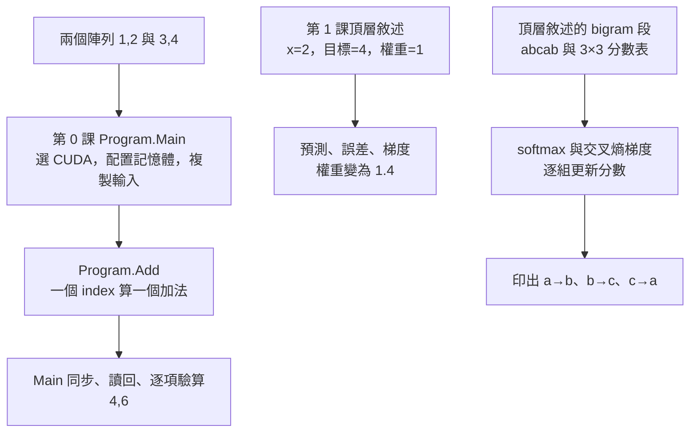
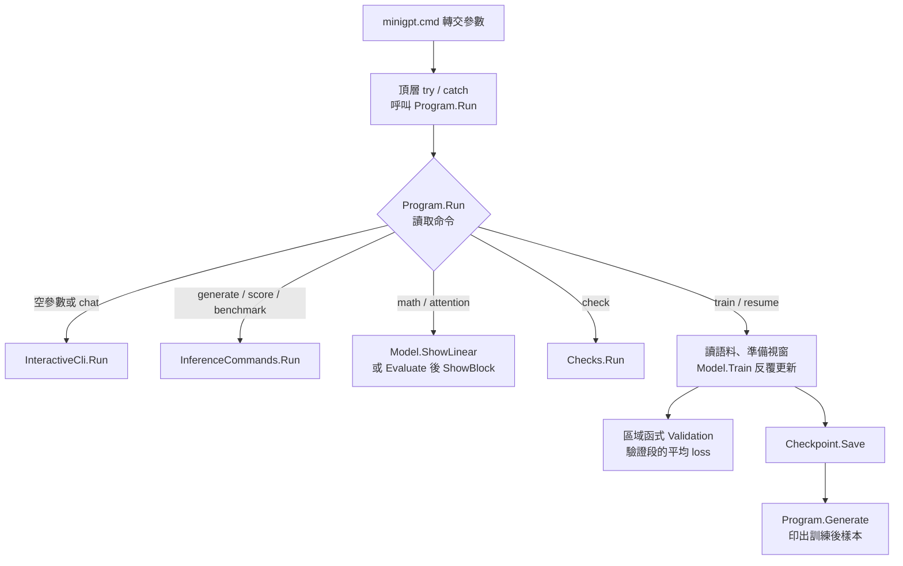
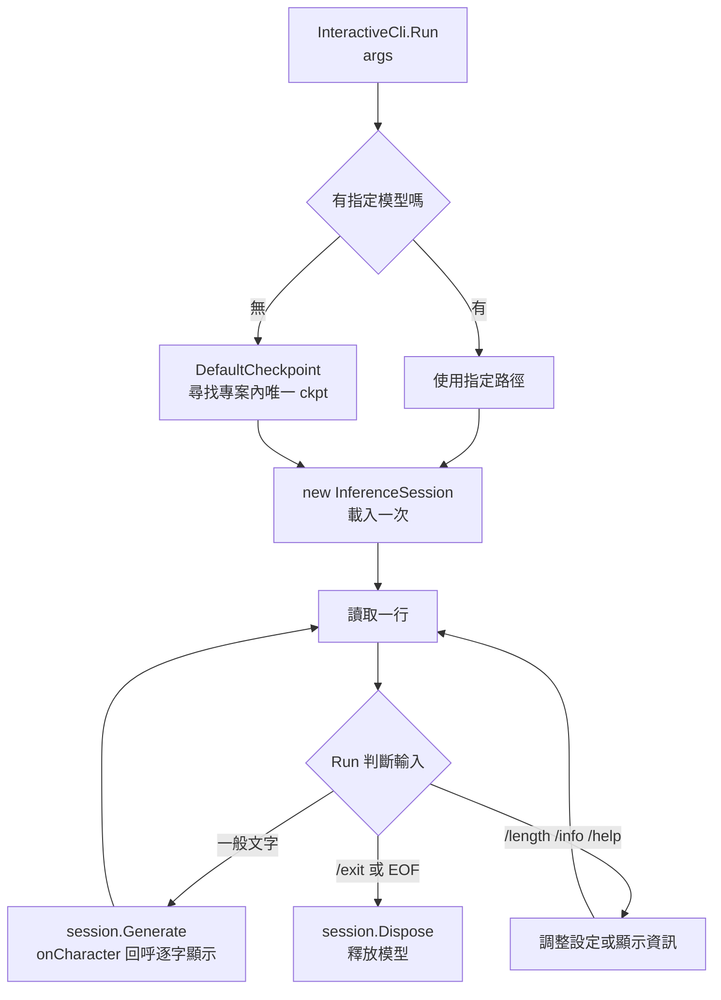
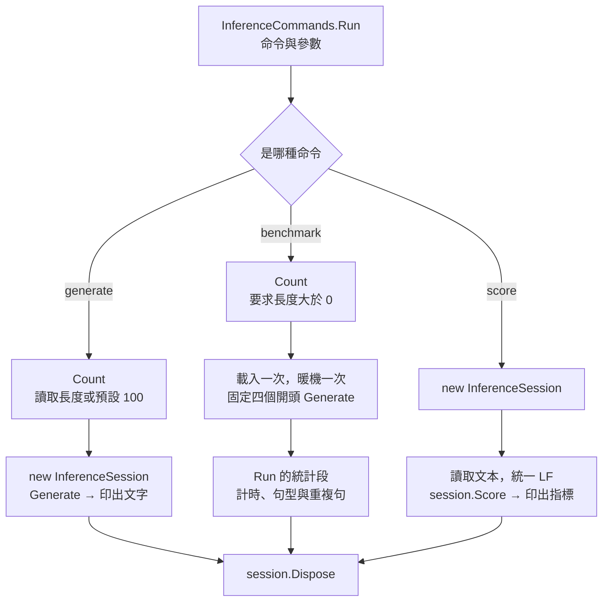
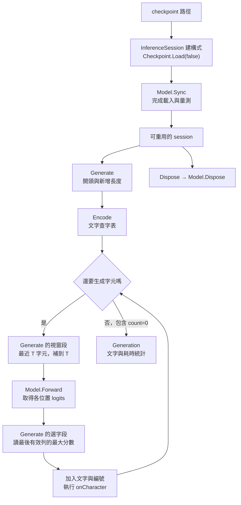
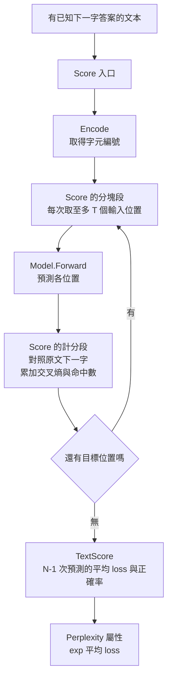
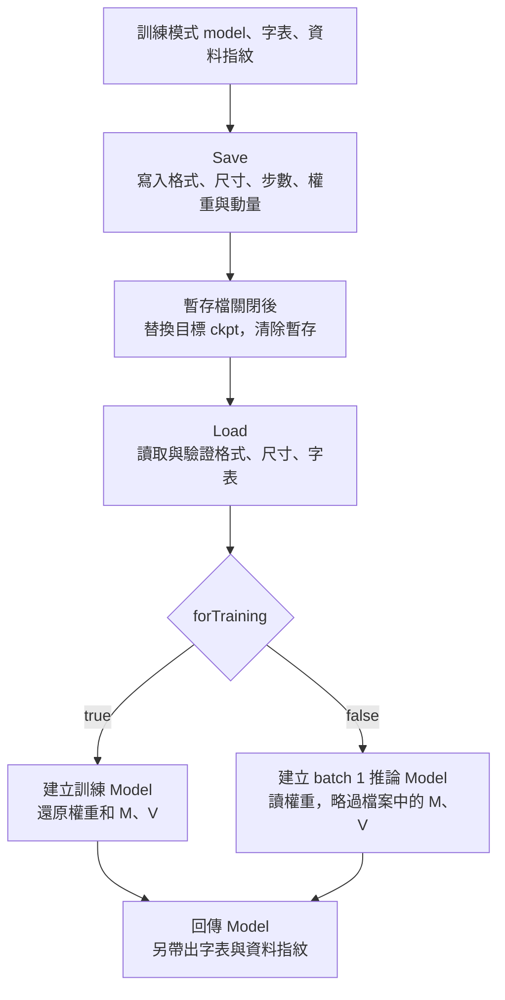
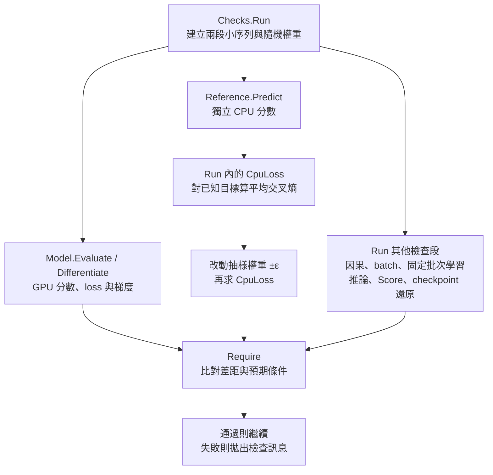

# 從命令列到文字輸出的函式圖解

先讀 [miniGPT 與推論引擎](../README.md)，再沿這份文件追蹤「載入一次、生成一次、評分一次」。[模型函式圖解](model-functions.md) 接著說明 GPU 計算。

每張圖把相關函式放在一起，每一列說明一個具名函式的輸入、動作與輸出。建構式負責建立物件，Dispose 負責釋放資源。區域函式會標出它所屬的外層函式。record 是保存結果或設定的資料型別。

## 第 0、1 課如何走進完整專案

第 0 課有兩個手寫函式。第 1 課則直接由檔案頂層敘述執行兩段練習。下面的區塊名稱對應程式中的運算段落。

| 函式或區塊 | 輸入 | 做的事 | 輸出或狀態 |
|---|---|---|---|
| 第 0 課 Program.Main | 程式內兩組整數 | 選裝置、編譯 Add kernel、傳資料、執行、同步與驗算 | 結果、結束碼 0 或 1 |
| 第 0 課 Program.Add | index 與三個 GPU ArrayView | 把相同位置的兩數相加 | 寫入 result[index] |
| 第 1 課單權重頂層敘述 | 輸入、目標、權重 | 用半平方誤差求梯度，更新一次 | 新權重及更新前後 loss |
| 第 1 課 bigram 頂層敘述 | 原文與分數表 | 反覆取相鄰字，更新下一字的候選分數 | 三個字各自最可能接的下一字 |

對照 [CUDA 程式](../lessons/00-cuda/Program.cs) 與 [學習程式](../lessons/01-learning/Program.cs)。

## Program.cs 決定這次要做什麼

| 函式或區塊 | 輸入 | 做的事 | 輸出或狀態 |
|---|---|---|---|
| 頂層入口 | 命令列 args | 呼叫 Run，將檔案錯誤轉為一般提示 | 程式結束碼 |
| Program.Run | args | 分派命令，訓練時讀資料、建 batch、執行更新與存檔 | 成功 0、無效命令 1，或交給入口處理錯誤 |
| Run 內的 Validation | 外層的 model、驗證段、T 與 batch | 取完整驗證視窗，重複填滿 batch，呼叫 Evaluate | 各完整視窗平均 loss |
| Program.Generate | 已在訓練中使用的 Model、字表、開頭、長度 | 保留最近 T 字元，呼叫 Forward，逐次取最大分數 | 包含開頭的樣本文字 |

Program.Generate 供訓練結束後列印樣本使用，與下面的 InferenceSession.Generate 都沿用模型前向計算。前者使用訓練中的 model，後者管理專門載入的推論 model。[程式入口](../lessons/miniGPT/Program.cs)

## 互動介面如何一直等待下一次輸入

| 函式 | 輸入 | 做的事 | 輸出或狀態 |
|---|---|---|---|
| InteractiveCli.Run | 可選 checkpoint 路徑 | 建立 session、讀取輸入、解析斜線指令，將新字元寫到 Console | 連續續寫與結束碼 0 |
| InteractiveCli.DefaultCheckpoint | 執行目錄 | 向上找 MiniGPT.csproj，確認該專案內恰有一個 ckpt | 模型路徑，零檔或多檔時給提示 |

空字串會回到輸入提示，單一空白則能作為模型輸入。字表外文字顯示錯誤後，可以繼續輸入。onCharacter 是傳給 Generate 的回呼，每產生一個新字元，就執行 Console.Write。[互動介面](../lessons/miniGPT/InteractiveCli.cs)

## 單次指令如何共用同一套推論程式

每次命令都建立自己的 session。benchmark 在一次執行中，會讓四個開頭共用同一個已載入的 session。

| 函式 | 輸入 | 做的事 | 輸出或狀態 |
|---|---|---|---|
| InferenceCommands.Run | generate、benchmark 或 score 參數 | 建立 session、執行要求並顯示結果 | 結束碼 0，參數錯誤時拋出提示 |
| InferenceCommands.Count | args 與長度參數的位置 | 省略時回傳 100，有提供時解析非負整數 | 新增字元數 |

benchmark 的句型檢查與計時寫在 Run 的命令分支中。它使用教材英文提示詞，對每個開頭各自計算完整句與重複句。[單次命令](../lessons/miniGPT/InferenceCommands.cs)

## InferenceSession 如何載入、編碼與生成

| 函式 | 輸入 | 做的事 | 輸出或狀態 |
|---|---|---|---|
| InferenceSession 建構式 | checkpoint 路徑 | 載入推論模式 model 與字表，同步並記錄時間 | session，可讀取 Device、Step、LoadMs 等資訊 |
| Encode | 文字 | 把每個 UTF-16 字元查成字表編號，遇到字表外字元時提示 | int[] |
| Generate | prompt、count、可選 onCharacter | 驗證輸入、逐次前向計算與貪婪選字、記錄首字及整段時間 | Generation，文字含原開頭 |
| Dispose | 已載入的 session | 呼叫 model.Dispose | 釋放 GPU 資源 |

count=0 時回傳原開頭。若開頭超過 T，先驗證全部字元，再只取最近 T 字元計算。補齊的位置不影響先前有效位置，這由模型的因果遮罩保證。[推論 session](../lessons/miniGPT/InferenceSession.cs)

## Score 如何把前向分數變成評估指標

| 函式或屬性 | 輸入 | 做的事 | 輸出 |
|---|---|---|---|
| InferenceSession.Score | 至少兩字的文本 | 每 T 位置重置上下文，逐位置計分，尾段也計入，求平均 | TextScore |
| TextScore.Perplexity | TextScore.Loss | 計算 Math.Exp(Loss) | 字元 perplexity |

例如 abcab 有四個下一字元目標 b、c、a、b。使用較小的 T=3 時，前三個目標放第一段，最後一個放尾段，每個目標恰好評一次。這裡的已知文本評分和逐字生成使用不同的上下文切法。

Generation 保存 Text、NewCharacters、FirstCharacterMs、CharactersPerSecond。TextScore 保存 Predictions、Loss、Accuracy。這兩個 record 的建構式由 C# 依欄位自動產生，運算邏輯集中在上表。

## Checkpoint 如何連接訓練與推論

| 函式 | 輸入 | 做的事 | 輸出或狀態 |
|---|---|---|---|
| Checkpoint.Save | path、訓練 model、alphabet、dataHash、overwrite | 寫完整暫存檔，再換到目標路徑，finally 清除暫存 | ckpt 檔案 |
| Checkpoint.Load | path、forTraining | 檢查 MiniGPT/1，依參數順序還原資料，檢查檔案完整性 | Model，以及 out 字表、語料指紋 |

Save 的 overwrite 預設為 false。Load 失敗時會 Dispose 已建立的 model，再回報錯誤。M 是梯度移動平均，V 是梯度平方移動平均，保存它們可以接續 AdamW 更新。[模型存檔](../lessons/miniGPT/Checkpoint.cs)

## Checks 如何核對模型

| 函式 | 輸入 | 做的事 | 輸出或狀態 |
|---|---|---|---|
| Checks.Run | 程式內設定的小模型與例子 | 比較 CPU/GPU 分數和 loss，從每組參數抽一個元素驗梯度，再做遮罩、學習與還原檢查 | 通過訊息，或中斷於失敗項目 |
| Checks.Require | condition、message | 判斷條件是否成立 | 成立則返回，失敗則拋例外 |
| Run 內的 CpuLoss | 外層目前權重、input、target | 呼叫 Reference.Predict，再用 double 計算平均交叉熵 | 一個可與 GPU 對照的 loss |

CpuLoss 會讀到外層被暫時加減的權重，因此能用兩次獨立 loss 估計該元素的斜率。檢查結束前會把該元素還原。[檢查程式](../lessons/miniGPT/Checks.cs)

接著閱讀 [Model、Kernels 與 Reference 的函式圖解](model-functions.md)，把 Model.Forward 展開到每個 GPU 運算。
