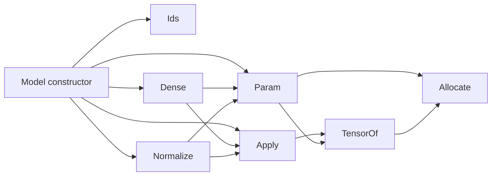
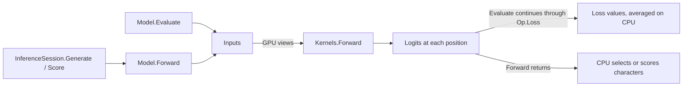
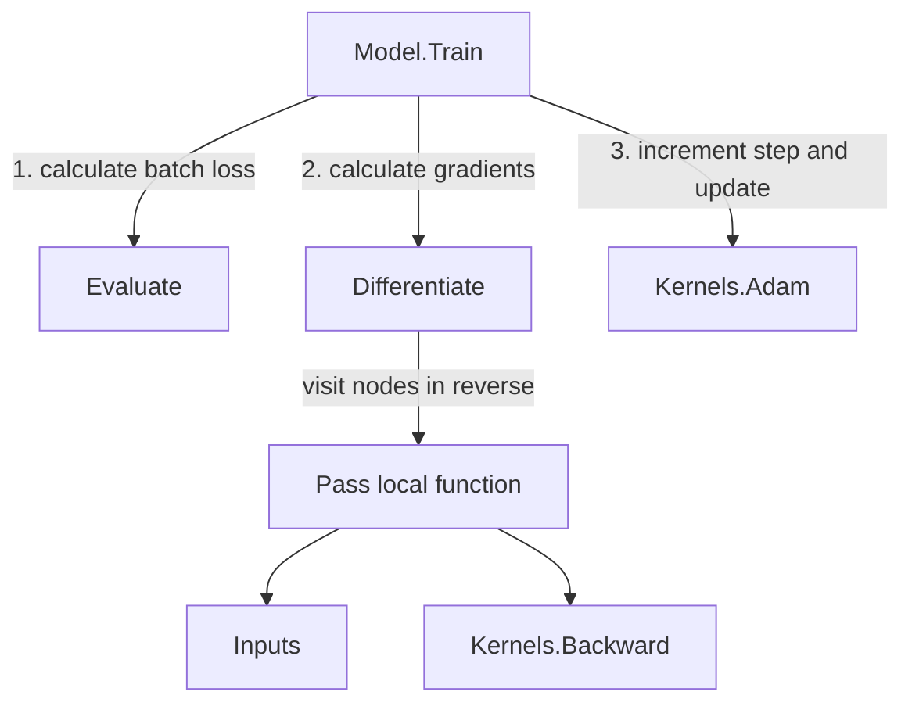

# Trace GPT Computation Through the C# Functions

[Project overview](../README.md) · [Traditional Chinese](model-functions.zh-TW.md) · [Command and inference functions](functions.en.md)

Suppose the prompt is `the`. The program maps its three characters to vocabulary IDs, then the model produces a row of candidate-character scores (logits) for each position. The inference engine reads the third row, chooses the highest score, appends that character, and calculates again. This guide starts where the model receives integer IDs.

## 1. The constructor builds an ordered computation graph

Each operation is recorded as a `Node` with an operation type, inputs, and output. A later node can refer to an earlier node's output. These connected operations form a **computation graph**. The constructor allocates storage and connects operations; actual values are calculated when input data is evaluated. Arrows show calls or data flow. [Model.cs](../lessons/my-gpt/Model.cs)

The default model represents a text segment as 64 positions of 64 numbers each. The row count below is `Batch × T`. GPU values are stored in flat one-dimensional arrays; for width 64, row 2 begins at index 64.

| Function | Input | What it does | Output or observable result |
|---|---|---|---|
| `Model(...)` | Configuration, vocabulary size, training flag | Selects CUDA, loads kernels, builds character/position embeddings, Transformer blocks, output projection, and loss node | Model; training mode also creates gradient, optimizer, and backward resources |
| `Allocate` | Number of float values | Allocates an FP32 GPU buffer and records it for disposal | GPU storage |
| `Ids` | CPU integer array | Allocates an integer GPU buffer and copies the values | GPU IDs for characters, targets, or positions |
| `TensorOf` | Element count | Allocates values and, in training mode, a same-sized gradient buffer | `Tensor` |
| `Param` | Name, element count, optional initialization | Initializes constants or small random values, records weight decay, and in training mode creates zero-initialized Adam moments | Registered model parameter |
| `Apply` | Operation, shape, input tensors, optional IDs | Allocates output and connects a node to the graph | Output tensor for later operations |
| `Dense` | Name, input tensor, input/output widths | Creates weight and bias parameters and connects `Linear` then `Bias` | Tensor with the requested output width |
| `Normalize` | Name and input tensor | Connects row normalization, trainable `Gain`, and `Bias` | LayerNorm tensor with the input shape |

## 2. Evaluate for loss or run a forward pass for logits

Both paths execute the same graph. `Evaluate` needs correct targets and is used to measure prediction error. `Model.Forward` only needs input IDs and returns scores for inference. C# arranges graph nodes; GPU kernels perform their mathematics. [Model.cs](../lessons/my-gpt/Model.cs) · [InferenceSession.cs](../lessons/my-gpt/InferenceSession.cs)

| Function | Input | What it does | Output or observable result |
|---|---|---|---|
| `Inputs` | A graph node | Gets GPU views for A, B, and integer IDs; a single-input operation reuses A's view for B | `Values` view for a kernel, with data kept on GPU |
| `Evaluate` | Input and target IDs, each of length `Batch × T` | Uploads IDs, executes the full graph, reads per-position losses back and averages them on CPU | Batch-average cross-entropy; intermediate GPU values remain available for backward pass |
| `Model.Forward` | Input IDs of length `Batch × T` | Uploads IDs and executes through final logits, stopping before the loss node | CPU float array in batch, position, candidate-character order |

Inference encodes text, builds a fixed-size window from recent characters, and chooses the next character. For `the`, the default inference input occupies the first three positions of a 64-position window. The model calculates 64 rows of logits; causal masking means the first three rows cannot be affected by later padding. The engine selects row index 2. Text scoring reads the valid rows and compares them to the known next characters.

## 3. Backpropagation updates the weights

A gradient answers: “If this weight changes slightly, how does the average loss change?” A tensor may be used in multiple paths, such as attention and a residual connection. Backpropagation adds the contributions from each path. [Model.cs](../lessons/my-gpt/Model.cs) · [Kernels.cs](../lessons/my-gpt/Kernels.cs)

| Function | Input | What it does | Output or observable result |
|---|---|---|---|
| `Train` | Inputs, targets, learning rate | Calculates loss, checks it is finite, computes gradients, increments step, and updates each parameter | Returns the batch loss before the update; queues updated weights and optimizer state on GPU |
| `Differentiate` | Intermediates from the latest `Evaluate` and graph connections | Clears old gradients, seeds each loss gradient with `1 / (Batch × T)`, then walks nodes backward | Accumulated gradients in GPU `Grad` buffers |
| `Pass` (local function in `Differentiate`) | Current node input and side A or B | Runs the GPU derivative for each input element; called for both sides of a two-input operation | Adds contributions into the selected input gradient |

## 4. What each GPU worker calculates

ILGPU launches many workers for each kernel. A worker in `Kernels.Forward` calculates one output element. A worker in `Kernels.Backward` gathers all contributions for one input element. A worker in `Kernels.Adam` updates one parameter element. Each uses its index to find the assigned location. [Kernels.cs](../lessons/my-gpt/Kernels.cs)

| Function | Input | What it does | Output or observable result |
|---|---|---|---|
| `Kernels.Forward` | Output index, operation, shape, input and output views | Selects the operation rule and calculates one output element | Writes that element in the GPU output view |
| `Kernels.Backward` | Input index, operation, values, output gradient, A/B side, gradient destination | Applies the derivative and gathers contributions for one input element | Adds to that element's gradient |
| `Statistics` | Input view, row start, width | Calculates mean and variance, adds `0.00001`, and takes the reciprocal square root | Mean and inverse scale for normalization and its gradient |
| `TanhTerm` | Number `x` | Calculates the hyperbolic-tangent term in the GELU approximation | Value shared by GELU forward and derivative calculations |
| `Kernels.Adam` | Parameter index, weight, gradient, two moments, bias corrections, decay, learning rate | Updates moving averages, corrects early bias, applies AdamW update and weight decay | Updated weight and moments in place |

The same operation has a forward and backward rule. For example, if `Add` calculates `a + b`, changing either input by one changes the output by one, so both receive the output gradient.

| Operation | Forward calculation | Where the backward gradient goes |
|---|---|---|
| `Embed` | Use an integer ID to look up a character or position vector | Add contributions to the looked-up row; integer IDs have no gradient |
| `Add` | Add two same-shaped tensors element by element | Each input receives the output gradient at that position |
| `Linear` | Multiply input matrix A by weight matrix B | Propagate through B to A; sum row contributions into B's gradient |
| `Bias` | Add the same per-column offset to each row | Input gets the original gradient; sum rows by column into bias |
| `Gain` | Multiply each row by trainable per-column scale | Scale the input gradient; sum input × output gradient across rows for the scale |
| `Norm` | Normalize each row using its mean and standard deviation | Each element affects the row mean and variance, so read other row elements too |
| `Scores` | Dot Q and K vectors for a batch, position pair, and head; divide by square root of head width | Gather each pair's contributions to Q and K using the same scale |
| `Softmax` | Stable row-wise exponential normalization; future positions get zero weight | Distribute row gradients through the probabilities; future positions receive zero |
| `Mix` | Weighted sum of visible V vectors | Send contributions to both attention weights and the selected V vectors |
| `Gelu` | Apply a smooth nonlinearity to each feed-forward value | Multiply output gradient by the GELU derivative |
| `Loss` | Calculate cross-entropy from row logits and the correct ID | Probability minus the one-hot target, multiplied by the loss gradient |

## 5. Observe results and release the GPU

| Function | Input | What it does | Output or observable result |
|---|---|---|---|
| `ShowLinear` | Built-in pair of 2×2 matrices | Runs `Linear`, reads results to the CPU, and checks the expected values | Prints `[4, 6, 10, 12]` or throws on mismatch |
| `ShowBlock` | Most recent graph nodes and attention weights | Lists operations and shapes; reads back the first sequence/head's softmax weights | Shows how each position attends to earlier positions |
| `Sync` | Queued work on the current GPU | Waits for queued operations to finish | Allows accurate timing afterward |
| `Dispose` | Model GPU resources | Releases registered buffers, device, and ILGPU context | Frees model resources |

## 6. Use an independent CPU reference

The `check` command also sends the same weights and IDs through a CPU implementation. `Reference.Predict` uses double-precision values and two-dimensional arrays to directly recalculate the logits. It can reveal numerical or indexing mistakes. Slightly increase and decrease one weight, then compare the two losses to independently estimate that weight's gradient. [Reference.cs](../lessons/my-gpt/Reference.cs) · [Checks.cs](../lessons/my-gpt/Checks.cs)

| Function | Input | What it does | Output or observable result |
|---|---|---|---|
| `Reference.Predict` | Configuration, vocabulary size, named weights, input IDs | Looks up embeddings and calculates normalization, Q/K/V, causal attention, residuals, feed-forward layers, and output projection | `double[,]` logits, one row per position |
| Local `Linear` (inside `Predict`) | Layer name, input matrix, output width | Runs matrix multiplication in loops, adding bias when that layer has one | New two-dimensional matrix |
| Local `Norm` (inside `Predict`) | Layer name and input matrix | Normalizes each row with a small stability constant, then applies learned scale and bias | LayerNorm matrix, matching GPU `Norm → Gain → Bias` |
| Local `Add` (inside `Predict`) | Same-shaped matrices A and B | Adds B element by element into A for residual connections | A is updated in place |

Continue with [command, inference, checkpoint, and check functions](functions.en.md).
