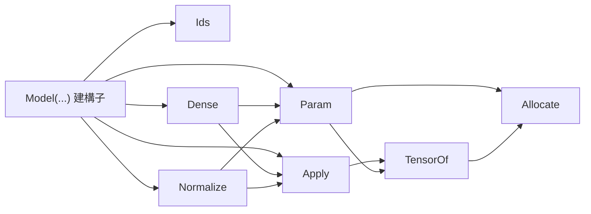
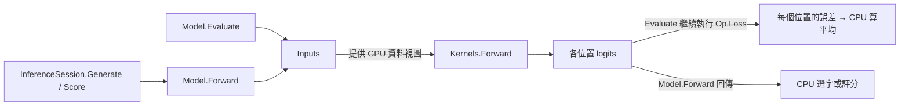
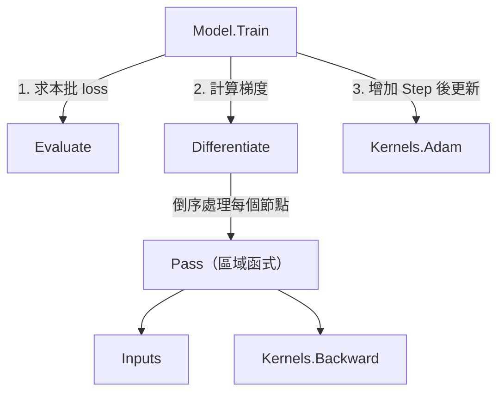
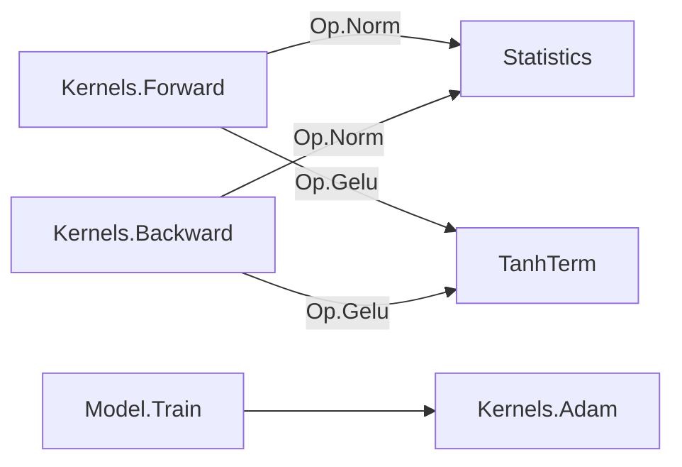
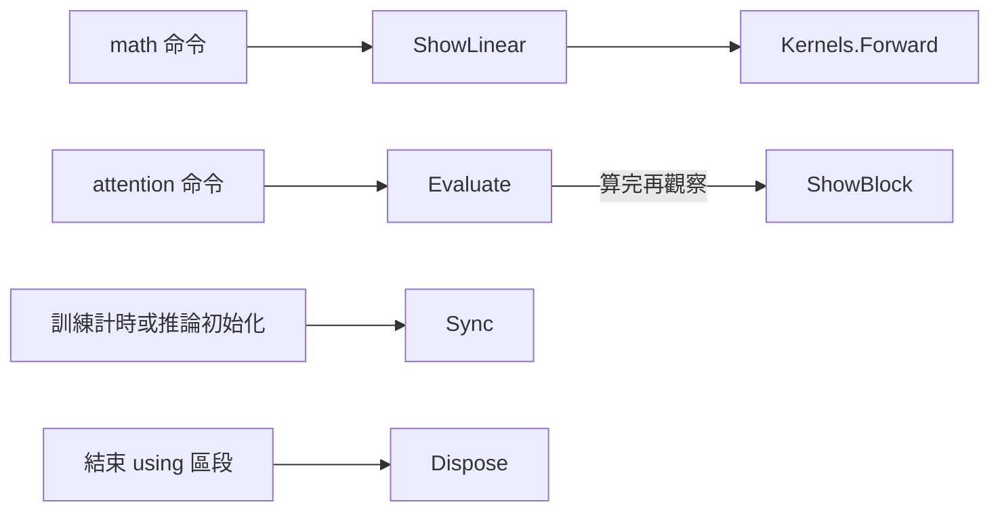
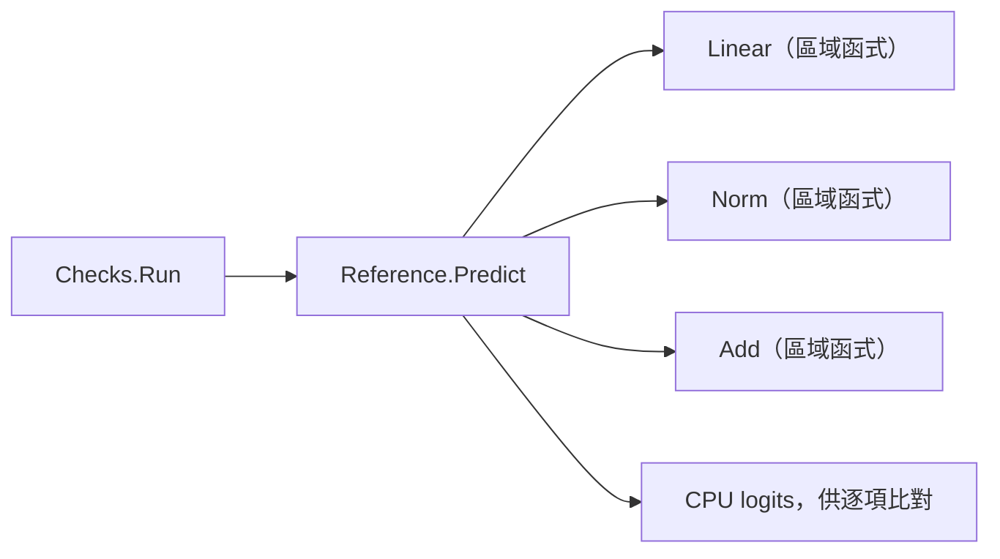

# 從 C# 函式追蹤一次 GPT 計算

[專案總覽](../README.md) · [命令、推論與存檔函式圖解](functions.md)

假設開頭是 `the`。程式先將三個字元編成字表中的整數編號，再把編號送進模型。模型為每個位置產生一列候選字元分數，稱為 logits。要接續這個開頭，推論引擎讀取第 3 列，選出分數最高的字元，接到文字後再計算一次。這一頁從模型收下整數編號的地方開始讀。

## 1. 建立模型時，先排好計算順序

模型把每個運算記成一個 `Node`，其中包含運算類型、輸入和輸出。下一個節點可以直接引用前一個節點的輸出。這些有先後關係的節點合起來稱為**計算圖**。建立時配置空間，送入實際資料後才依序執行。圖中的箭頭代表左方函式會呼叫右方函式。[Model.cs](../lessons/miniGPT/Model.cs)

預設模型把每段文字切成 64 個位置，每個位置用 64 個數字表示。下表的「列數」為每批段數 `Batch` 乘以每段位置數 `T`。GPU 實際上使用一維陣列。例如寬度 64 的第 2 列，從索引 64 開始。

| 函式 | 輸入 | 處理 | 輸出或可觀察結果 |
|---|---|---|---|
| `Model(...)` | 模型設定、字表大小、是否訓練 | 選 CUDA 裝置、載入 kernel、建立字元與位置嵌入、各 Transformer 層、最後的分類權重及 loss 節點 | 可重複處理資料的模型。訓練模式也會建立梯度、AdamW 動量及反向 kernel |
| `Allocate` | 浮點數個數 | 建立 GPU 的 FP32 緩衝區，登記其大小與釋放責任 | 可存放這些數值的 GPU 空間 |
| `Ids` | CPU 的整數陣列 | 建立 GPU 整數緩衝區並複製內容，登記大小 | 字元、目標或位置的 GPU 編號陣列 |
| `TensorOf` | 元素個數 | 配置數值空間，訓練時另配同樣大小的梯度空間 | 一個 `Tensor`，可從 `Value` 讀寫數值 |
| `Param` | 參數名稱、元素個數、可選的初值 | 用指定常數或小隨機數初始化，記錄名稱及權重衰減係數。訓練時建立兩組初值為零的動量 | 註冊於模型參數清單中的張量 |
| `Apply` | 運算類型、形狀、輸入張量及選用的編號 | 配置輸出，將連接關係加入計算圖 | 後續節點能引用的輸出張量 |
| `Dense` | 名稱、輸入張量、輸入及輸出寬度 | 建立權重及偏移量，依序接上 `Linear` 和 `Bias` | 列數相同、每列改成指定寬度的張量 |
| `Normalize` | 名稱、輸入張量 | 接上 `Norm` 做逐列標準化，再接可學習的逐欄縮放 `Gain` 與偏移 `Bias` | 形狀與輸入相同的 LayerNorm 結果張量 |

## 2. 送入一批資料，得到分數或誤差

同一張圖有兩種常用的走法。`Evaluate` 需要正解，用於衡量每一列的預測。`Model.Forward` 只需要字元編號，供推論引擎讀取分數。兩者都在 CPU 安排節點順序，由 GPU 執行節點的數學。[Model.cs](../lessons/miniGPT/Model.cs) · [InferenceSession.cs](../lessons/miniGPT/InferenceSession.cs)

| 函式 | 輸入 | 處理 | 輸出或可觀察結果 |
|---|---|---|---|
| `Inputs` | 一個節點 | 取得 A、B 與整數編號的 GPU 視圖。單輸入運算的 B 欄位借用 A 的視圖 | kernel 可直接存取的 `Values`，資料保留在 GPU |
| `Evaluate` | 長度都等於 `Batch × T` 的輸入編號與正解編號 | 上傳兩組編號，執行全圖，將各位置 loss 取回 CPU 求平均 | 本批平均交叉熵。GPU 保留反向計算所需的中間值 |
| `Model.Forward` | 長度等於 `Batch × T` 的輸入編號 | 上傳輸入，執行至最後一層 logits，在 loss 節點前停止 | CPU 浮點數陣列，排列順序是「批次、位置、候選字元」 |

推論引擎負責把字串編碼、從最近的文字建立固定長度視窗，以及挑選下一字元。在預設的單筆推論中，`the` 的編號放在 64 格視窗的前 3 格。模型照常算出 64 列 logits。因果遮罩使前 3 列只看得見各自位置及其前文。引擎取索引 2 的那一列選字。文本評分則讀取各有效列，比對實際的下一字元。

## 3. 用誤差更新一次權重

訓練要回答「若稍微改變某個權重，平均 loss 會怎樣改變？」這個變化率就是梯度。一個張量可能被多條路徑使用，例如殘差相加與注意力都會讀到同一份輸入。反向計算會將各路徑的貢獻加在一起。[Model.cs](../lessons/miniGPT/Model.cs) · [Kernels.cs](../lessons/miniGPT/Kernels.cs)

| 函式 | 輸入 | 處理 | 輸出或可觀察結果 |
|---|---|---|---|
| `Train` | 輸入、正解、學習率 | 求 loss、檢查為有限數、計算梯度、增加步數，逐組更新參數 | 回傳**更新前**的本批平均 loss。GPU 上的權重與動量已排入更新 |
| `Differentiate` | 最近一次 `Evaluate` 留下的中間值，以及各節點的連接關係 | 清除舊梯度，保留每列 loss 的起始梯度 `1 / (Batch × T)`，從最後一個節點往前走 | 各張量的梯度累加在 GPU 的 `Grad` 中 |
| `Pass`（在 `Differentiate` 內） | 當前節點的某個輸入，以及代表 A 或 B 的 `side` | 讓 GPU 對該輸入的每個元素計算梯度貢獻，雙輸入節點兩側各呼叫一次 | 貢獻加進所選輸入的 `Grad` |

## 4. GPU 的每個工作單元實際算什麼

ILGPU 會把三個 kernel 啟動成大量工作單元。`Kernels.Forward` 的一個工作單元算一個輸出元素。`Kernels.Backward` 的一個工作單元收集一個輸入元素收到的所有梯度貢獻。`Kernels.Adam` 的一個工作單元更新一個參數元素。三者各自使用傳入的索引找到負責的位置。[Kernels.cs](../lessons/miniGPT/Kernels.cs)

| 函式 | 輸入 | 處理 | 輸出或可觀察結果 |
|---|---|---|---|
| `Kernels.Forward` | 輸出索引、`Op`、形狀、輸入視圖、輸出視圖 | 依 `Op` 選擇下表的規則，計算一個元素 | 寫入 GPU 輸出視圖的對應位置 |
| `Kernels.Backward` | 輸入索引、`Op`、原輸入及輸出、輸出梯度、A/B 側、梯度目的地 | 依該運算的導數收集對一個輸入元素的影響 | 將貢獻加到該元素原有梯度 |
| `Statistics` | 輸入視圖、某一列的起點與寬度 | 先算平均與變異數，再將變異數加上 `0.00001`，開根號取倒數 | 兩個輸出值 `mean` 和 `inv`，供逐列正規化及其反向使用 |
| `TanhTerm` | 一個數字 `x` | 計算 GELU 近似公式中的雙曲正切項 | 一個可在 GELU 前向與導數中共用的值 |
| `Kernels.Adam` | 參數索引、權重、梯度、兩組動量、兩項步數修正、衰減係數、學習率 | 更新梯度及平方梯度的移動平均，修正初期偏差，套用 AdamW 的更新與權重衰減 | 就地寫回該元素的新權重與兩組動量 |

下表把同一個 `Op` 的兩個方向放在一起。以 `Add` 為例，如果輸出是 `a + b`，改變其中任一輸入 1 單位都會讓輸出改變 1 單位，因此兩邊都會收到相同的輸出梯度。

| `Op` 分支 | 前向的輸入與結果 | 反向把梯度傳到哪裡 |
|---|---|---|
| `Embed` | 用整數 ID 找到字元表或位置表的某一列，取出向量 | 同一列被查到多次時，將各次貢獻加到該列的權重。整數 ID 不求梯度 |
| `Add` | 對兩個相同形狀的張量逐項相加 | 各輸入都收到同位置的輸出梯度 |
| `Linear` | 輸入矩陣 A 乘權重矩陣 B | 透過 B 將梯度傳回 A。各輸入列對 B 的貢獻加總 |
| `Bias` | 每列加上同一組逐欄偏移量 | 輸入收到原梯度。同欄各列的梯度加到偏移量 |
| `Gain` | 每列乘上同一組逐欄縮放係數 | 輸入梯度乘上係數。以原輸入值乘上輸出梯度，跨列加總出係數的梯度 |
| `Norm` | 用同一列的平均與標準差將該列標準化 | 一個值會影響整列的平均與變異數，計算梯度時會讀取同列其他元素 |
| `Scores` | 對同一段、同一注意力頭的 Q 與 K 向量算內積，除以頭寬的平方根 | 分別收集每次配對對 Q 與 K 的影響，沿用同一縮放值 |
| `Softmax` | 對每列可見的注意力分數先減最大值，再做指數歸一化。未來位置權重為零 | 依同列注意力權重分配梯度，未來位置收到零 |
| `Mix` | 將可見位置的 V 向量依注意力權重加總 | 貢獻分別回到注意力權重與被讀取的 V |
| `Gelu` | 對前饋網路內的每個值套用平滑的非線性函式 | 每個輸出梯度乘以該位置 GELU 的導數 |
| `Loss` | 每列候選字元 logits 加上正解 ID，算出該位置的交叉熵 | 各候選字元的機率減去正解指示值（正解為 1，其餘為 0），再乘上該位置的輸出梯度 |

## 5. 如何觀察結果並釋放 GPU

| 函式 | 輸入 | 處理 | 輸出或可觀察結果 |
|---|---|---|---|
| `ShowLinear` | 內建的兩個 2 × 2 矩陣 | 啟動 `Linear`，把結果帶回 CPU，比對已知答案 | 印出 `[4, 6, 10, 12]`，結果不符時拋出例外 |
| `ShowBlock` | 最近一次計算留下的節點與注意力權重 | 列出各節點的運算與形狀，遇到注意力 softmax 就讀回第一段文字、第一個頭的權重 | 主控台可看到每列如何對之前的位置分配注意力 |
| `Sync` | 目前 GPU 裝置上已排入的工作 | 等待工作執行完畢 | 呼叫者可在此之後完成計時 |
| `Dispose` | 模型持有的 GPU 資源 | 依序釋放登記的緩衝區、裝置與 ILGPU context | 模型結束使用，佔用的資源獲得釋放 |

## 6. 用 CPU 建立可獨立核對的答案

執行 `check` 時，同一組權重與字元編號也會送進 CPU 版本。`Reference.Predict` 使用雙精度數字與二維陣列，直接照數學定義重算預測。它能用來比對 GPU 的數值和索引。把單個權重稍微調高與調低，再比兩次預測得到的 loss，也能獨立估計該權重的梯度。[Reference.cs](../lessons/miniGPT/Reference.cs) · [Checks.cs](../lessons/miniGPT/Checks.cs)

| 函式 | 輸入 | 處理 | 輸出或可觀察結果 |
|---|---|---|---|
| `Reference.Predict` | 設定、字表大小、依名稱索引的權重、輸入編號 | 查嵌入表，逐層算正規化、Q/K/V、因果注意力、殘差及前饋網路，最後投影到字表 | `double[,]` 的 logits，每列對應一個位置 |
| `Linear`（在 `Predict` 內） | 層名、輸入矩陣、輸出欄數 | 取出該層權重，用迴圈做矩陣乘法。有偏移量的層一併加入，最終輸出層 `head` 只用權重 | 新的二維矩陣 |
| `Norm`（在 `Predict` 內） | 層名、輸入矩陣 | 逐列減去平均，除以「變異數加上穩定用小常數」的平方根，再套用該層的縮放與偏移 | 完整 LayerNorm 的二維矩陣，對應 GPU 的 `Norm → Gain → Bias` |
| `Add`（在 `Predict` 內） | 原矩陣 A 與相同形狀的 B | 把 B 逐項加回 A，供殘差連接使用 | A 就地更新，函式本身不回傳矩陣 |
