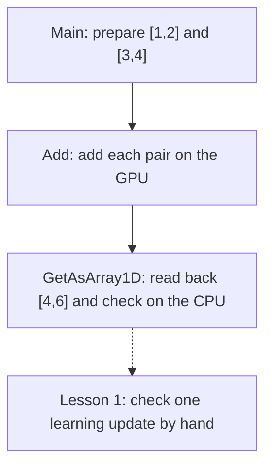

# Lesson 0: Run Your First Calculation on the Laptop GPU

[Function walkthrough](../../docs/functions.en.md) shows the inputs and outputs of `Main` and `Add`.



This is the first standalone example. Start with two small arrays, calculate the answer by hand, then check that C# performed the same calculation on an NVIDIA GPU. In GPT, each position also has a group of numbers, and the GPU calculates many positions at once.

## Run the lesson

1. Open PowerShell on a Windows computer with an NVIDIA GPU and driver. Run `nvidia-smi` and find the GPU in the device list. `dotnet --list-sdks` should include version 10.x or a later SDK that supports `net10.0`; `dotnet --list-runtimes` should include Microsoft.NETCore.App 10.x. If needed, install the [.NET 10 SDK](https://dotnet.microsoft.com/download/dotnet/10.0).
2. From the repository root (the folder containing `my-gpt.cmd`), run this command. The first run needs the ILGPU NuGet package in the local cache or access to download it.

   ```powershell
   dotnet run --project lessons/00-cuda/Lesson00.csproj
   ```

   If the project cannot be found, run `Test-Path .\lessons\00-cuda\Lesson00.csproj`. It should return `True` when PowerShell is in the repository root.

3. On the target laptop, expect output like this. The first line lists a detected device; the second identifies the device used for the addition.

   ```text
   CUDA device found: NVIDIA GeForce GTX 1650 with Max-Q Design
   Running on: NVIDIA GeForce GTX 1650 with Max-Q Design (CUDA)
   Result: [4,6]
   ```

Open [the lesson program](Program.cs) and start with `Main`. `left` and `right` are integer arrays in the laptop's main memory. `Allocate1D(left)` and `Allocate1D(right)` each copy an array to GPU memory. `Add` is a function that runs on the GPU, called a **kernel**. Calling `add(left.Length, ...)` assigns it two positions, each running the same addition.

`LoadAutoGroupedStreamKernel` prepares `Add` as a GPU program callable by the main program. The amount of work is `left.Length`, or the two rows below.

| Index (starts at 0) | left | right | result |
|---:|---:|---:|---:|
| 0 | 1 | 3 | 4 |
| 1 | 2 | 4 | 6 |

`Synchronize()` waits for the GPU to finish. `GetAsArray1D()` copies the result back to main memory. The final loop checks each value on the CPU. If no CUDA device is found, first check whether `nvidia-smi` lists the GPU. If another CUDA GPU is named, the addition ran on that device.

**Try it:** Change the second number in `right` from 4 to 10. Predict which result changes, then run the same command to check. Change 10 back to 4 afterward so the lesson remains reproducible.

If you can identify the line that sends numbers to the GPU and the line that reads the result back, you can trace a GPU calculation. Next, ask a different question: people write the addition rule, but how can a program adjust a number when given inputs and correct answers?

[Next: Lesson 1, adjust a weight from the error](../01-learning/README.md) · [Traditional Chinese](README.zh-TW.md) · [Project overview](../../README.md)
