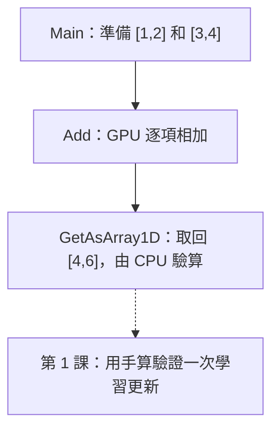

# 第 0 課　在筆電 GPU 上算出第一個答案

[本課函式圖解](../../docs/functions.md) 可對照 Main 與 Add 的輸入、處理及輸出。



這是第一個獨立範例。從兩組數字開始，你能用紙筆先算出答案，再確認 C# 真的把相同的計算交給了 NVIDIA 顯卡。之後在 GPT 中，一個位置也會有一組數字，GPU 會替許多位置同時計算。

1. 在裝有 NVIDIA 顯卡與驅動程式的 Windows 電腦上開啟 PowerShell。輸入 `nvidia-smi`，在裝置表中找到顯卡名稱。`dotnet --list-sdks` 應列出 10.x 或支援 net10.0 的更新 SDK，`dotnet --list-runtimes` 應列出 Microsoft.NETCore.App 10.x。若缺少環境，可安裝 [.NET 10 SDK](https://dotnet.microsoft.com/download/dotnet/10.0)。
2. 在專案根目錄（含 minigpt.cmd 的資料夾）執行下列指令。第一次執行需要 NuGet 套件快取或網路連線，以取得 ILGPU。

   ```powershell
   dotnet run --project lessons/00-cuda/Lesson00.csproj
   ```

   若提示找不到專案，用 `Test-Path .\lessons\00-cuda\Lesson00.csproj` 檢查目前位置；在正確的資料夾會得到 `True`。

3. 在目標筆電上，預期看到以下三行。第一行列出找到的裝置，第二行是程式實際用來執行加法的裝置。

   ```text
   找到 CUDA 裝置：NVIDIA GeForce GTX 1650 with Max-Q Design
   執行裝置：NVIDIA GeForce GTX 1650 with Max-Q Design (CUDA)
   結果：[4,6]
   ```

打開 [這一課的程式](Program.cs)，從 `Main` 看起。`left` 和 `right` 是筆電主記憶體裡的兩組整數。`Allocate1D(left)` 和 `Allocate1D(right)` 各把一組數字複製到顯卡記憶體。`Add` 是在 GPU 上執行的函式，稱為 **kernel**。呼叫 `add(left.Length, ...)` 會交給它兩個位置，各自執行同一行加法。

`LoadAutoGroupedStreamKernel` 把上方的 `Add` 準備成可從主程式呼叫的 GPU 程式。這次的工作數量是 `left.Length`，也就是下表的兩列。

| 位置 index（從 0 開始） | left | right | result |
|---|---:|---:|---:|
| 0 | 1 | 3 | 4 |
| 1 | 2 | 4 | 6 |

`Synchronize()` 等待 GPU 算完，`GetAsArray1D()` 把結果帶回主記憶體。最後的迴圈用 CPU 逐項驗算。若程式顯示找不到 CUDA 裝置，先看 `nvidia-smi` 能否列出顯卡。若看到其他 CUDA 顯卡的名稱，表示加法是在那張卡上執行。

**動手試**　把 `right` 的第二個數字從 4 改成 10。先寫下你預測會改變的位置和數值，再執行同一條指令核對。完成後把 10 改回 4，方便下次重現。

如果你能指出哪一行將數字送上 GPU、哪一行把結果帶回來，就能追蹤一次 GPU 計算。接著換一個問題：加法規則由人寫好，如果我們只給輸入與正確答案，程式怎麼學會調整數字？

[下一課：從誤差調整一個權重](../01-learning/README.md) · [專案總覽](../../README.md)
