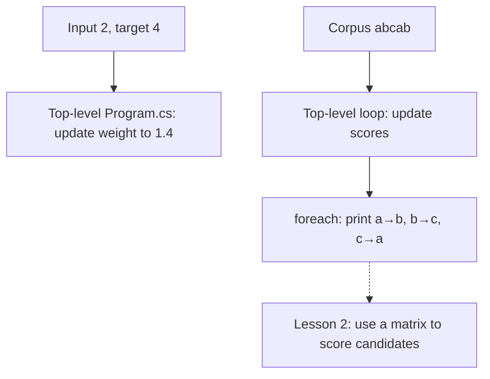

# Lesson 1: What Can One Update Learn?

[Function walkthrough](../../docs/functions.en.md) connects to the top-level examples for a single weight and a bigram.

Lesson 0 sent a specified addition to the GPU. This second standalone example runs on the CPU so you can follow learning in small steps: first adjust one multiplier based on its error, then adjust scores for three next-character candidates. You can compare every update in the program with a hand calculation. [Review Lesson 0](../00-cuda/README.md)

From the repository root, run `dotnet run --project lessons/01-learning`. Before running it, predict: input is 2, the target is 4, and the current weight is 1. Should the weight move up or down?

The program predicts 2, gives an error of −2, and calculates a gradient of −4. The gradient tells us which way the loss changes when the weight increases slightly. Moving in the opposite direction gives a new weight of 1.4, and loss falls from 2.00 to 0.72. The gradient is (prediction − target) × input, or (2 − 4) × 2 = −4. Try changing `0.1` in `weight -= 0.1 * gradient` to `0` and predict what happens to the loss.

Next, predict a character using only the previous character. This is called a **bigram**. Pair adjacent characters in `abcab` by hand: `ab`, `bc`, `ca`, `ab`. The program stores three candidate scores for each current character and uses softmax to turn scores into probabilities that sum to 1. During an update it raises the correct candidate's score and lowers the others. It should print a → b, b → c, and c → a. Replace the text with `acbac` and run it again to observe the three transitions.

When you see a → b, ask which training examples raised the score for b. A bigram stores one row of scores for each character. GPT needs to let those scores depend on more context. The next lesson starts with one part of this idea: multiply the numbers representing a position by learnable weights to score candidate characters.

[Next: Lesson 2, score candidates with a matrix](../my-gpt/README.md#lesson-2) · [繁體中文](README.zh-TW.md) · [Project overview](../../README.md)
