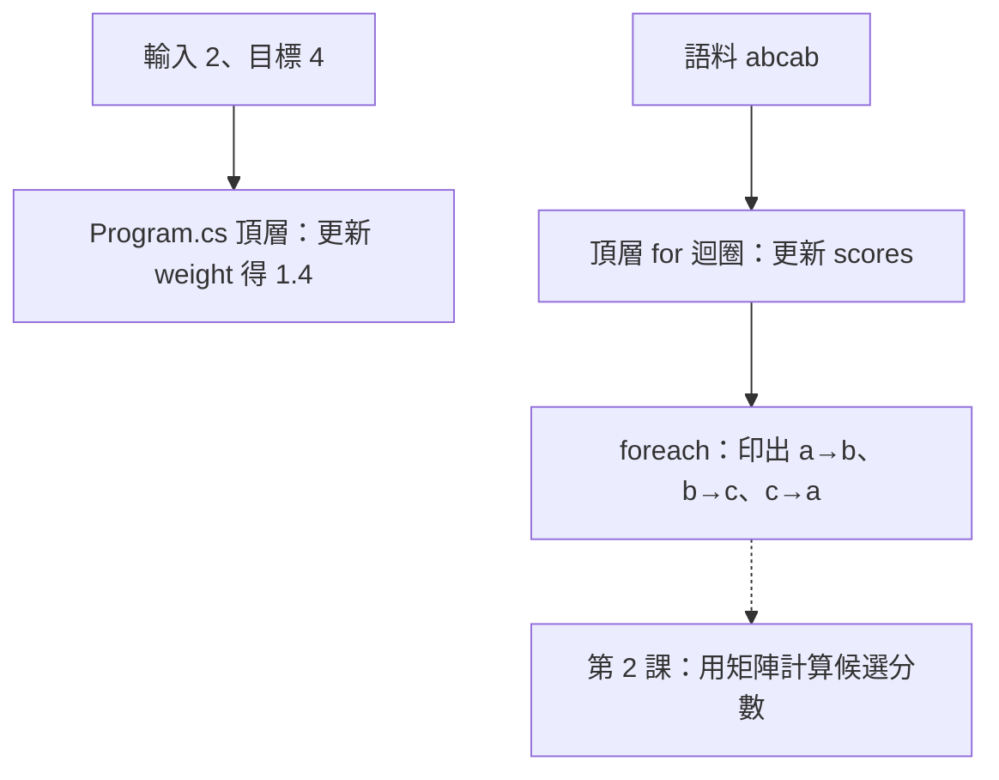

# 第 1 課：一次更新能學到什麼？

[本課程式區塊圖解](../../docs/functions.md) 可對照單權重更新與 bigram 兩段頂層敘述。

上一課把指定的加法交給 GPU。這一課用第二個獨立範例在 CPU 上追蹤學習的過程：先讓一個乘數隨誤差改變，再讓三個候選字的分數隨正確答案改變。你可以把程式中的每次更新和手算一一對上。[回看第 0 課](../00-cuda/README.md)

在專案根目錄執行 `dotnet run --project lessons/01-learning`。先猜：輸入 2，想得到 4，目前乘上的權重是 1。應該把它調大還是調小？

程式先算出預測 2、誤差 −2、梯度 −4。梯度描述權重稍微增加時 loss 往哪裡變。往梯度的反方向走，更新後權重是 1.4，loss 從 2.00 降到 0.72。梯度的算式是（預測 − 目標）× 輸入，即 (2 − 4) × 2 = −4。試著把 `weight -= 0.1 * gradient` 裡的 0.1 改成 0，預測 loss 的變化。

接下來只看前一個字來猜下一個字，稱為 bigram。用手把 `abcab` 的相鄰字配對，會得到 ab、bc、ca、ab。程式替每個目前字保存三個候選分數，用 softmax 將分數轉成總和為 1 的機率。更新時拉高正解的分數、拉低其他分數。最後應印出 a → b、b → c、c → a。把文本換成 acbac 再跑，觀察三個箭頭。

看到 a → b 時，試著解釋：哪兩個訓練例子拉高了 b 的分數？在 bigram 裡，a 對應分數表中的一列。GPT 需要讓這一列分數隨前文改變。下一課先做其中一步：把代表一個位置的數字乘上可學習的權重，算出各候選字的分數。

[下一課：用矩陣算候選字分數](../my-gpt/README.md#lesson-2) · [專案總覽](../../README.md)

