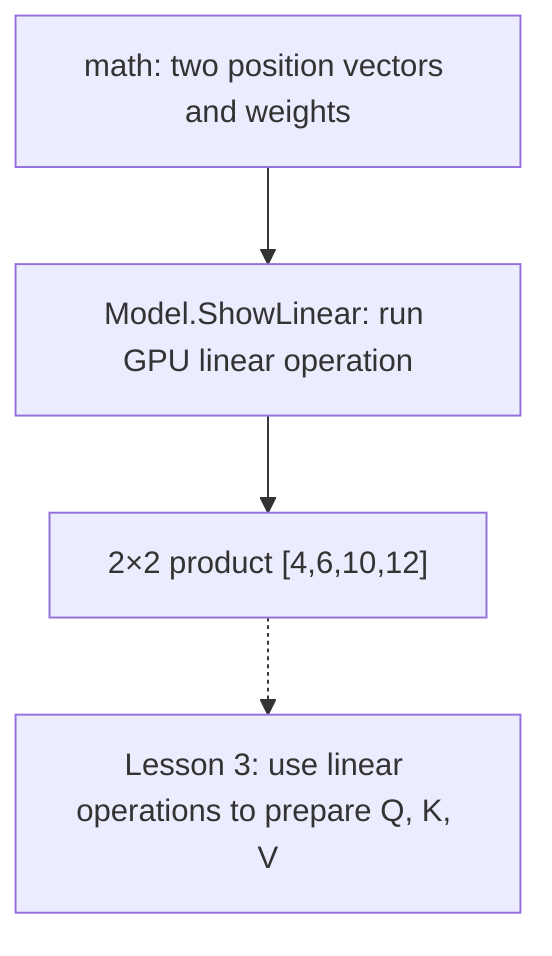
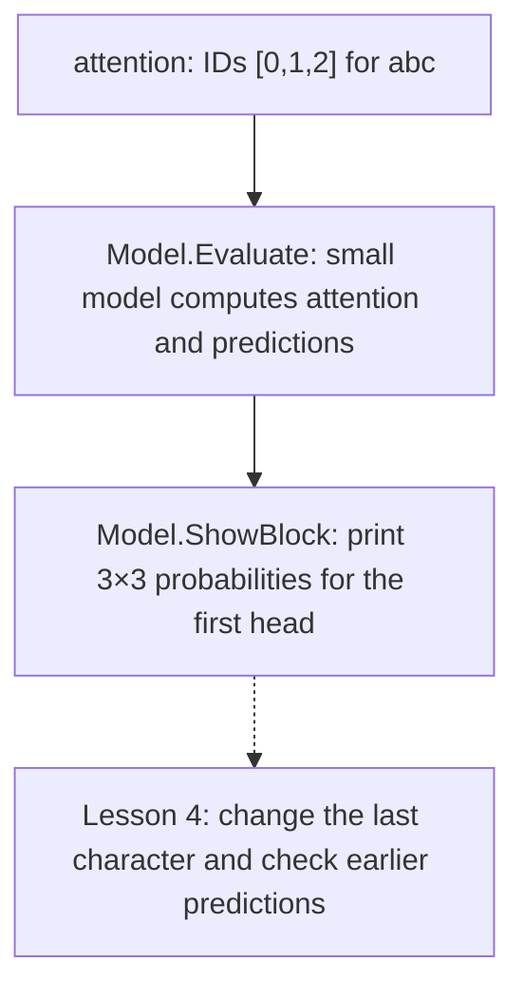
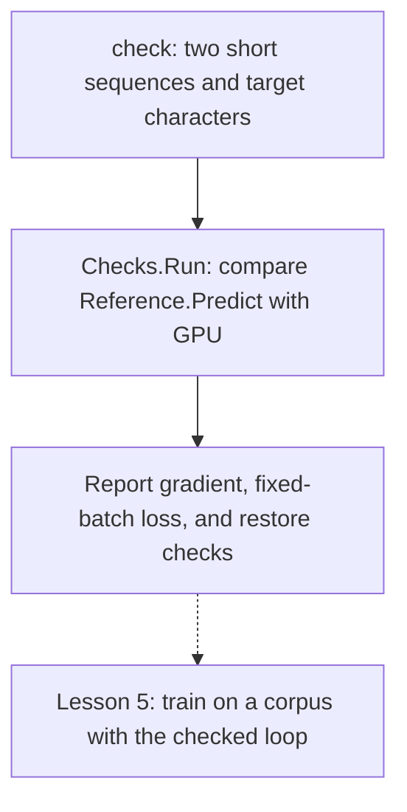
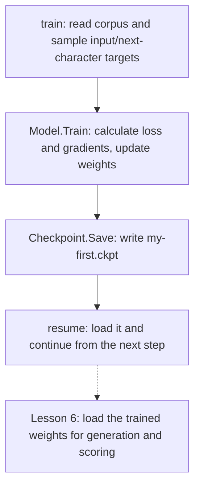
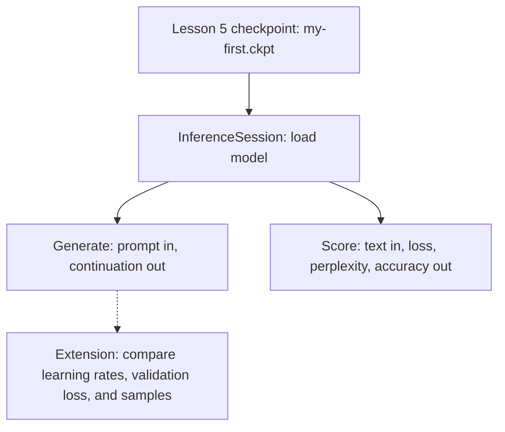

# From Matrix Multiplication to a Trainable my-gpt

[Application function diagrams](../../docs/functions.en.md) · [Model and GPU function diagrams](../../docs/model-functions.en.md). Start with each lesson's small diagram, then follow the matching function names in code. The my-gpt model computes scores for candidate characters; the inference engine loads, encodes, selects, and repeatedly generates characters. See the [project overview](../../README.md) for how they work together.

Run the examples from the repository root. Hardware and .NET setup are covered in [Lesson 0](../00-cuda/README.md). Each command starts a separate program. The command examples use `my-gpt.cmd`; paths are relative to the current working directory. Lesson 6's examples require a checkpoint created in Lesson 5.

Lessons 0 and 1 are separate small programs. Lessons 2–6 use one GPT implementation. `math` isolates a linear operation; `attention` and `check` use a smaller model for easier inspection. Lesson 5 trains and saves weights, which Lesson 6 loads. To follow the core implementation, start with [Model.cs](Model.cs) to see how a character passes through the Transformer, then read [Kernels.cs](Kernels.cs) to see how each operation runs on the GPU.

[Previous: bigram](../01-learning/README.md) · [Scores](#lesson-2) · [Attention](#lesson-3) · [Checks](#lesson-4) · [Training](#lesson-5) · [Inference](#lesson-6) · [繁體中文](README.zh-TW.md) · [Project overview](../../README.md)

<a id="lesson-2"></a>

## Lesson 2: Calculate the scores



Lesson 1 looked up a row of scores for the current character. Now represent each position with a vector and use the same weights to score every position. Keep track of which row is an input position and which column is a candidate character.

Run `dotnet run --project lessons/my-gpt -- math`. Suppose the two position vectors are [1,2] and [3,4], while the candidate weights are [2,1] and [0,3]. For the first position the scores are 1×2 + 2×1 = 4 and 1×0 + 2×3 = 6. Calculate the second position by hand, then compare all four values [4,6,10,12] with the GPU output. This small example checks matrix multiplication. When the final model layer has one column per character, its scores are called **logits** and can be greater than 1.

Recall softmax from Lesson 1. If three candidate probabilities are [0.1,0.6,0.3] and the correct candidate is the second one, cross-entropy loss is −ln(0.6) ≈ 0.511. If the model raises the correct probability to 0.9, what is the loss? Check by calculating −ln(0.9) ≈ 0.105. The `Linear` operation in [Kernels.cs](Kernels.cs) calculates scores; `Loss` uses a numerically stable equivalent formula for each position.

If you can point to the score 10 (the first candidate at the second position) and explain why a higher probability for the correct answer lowers loss, you understand the output layer. But if every position only multiplies its own numbers by the weights, how can the score change with earlier context?

<a id="lesson-3"></a>

## Lesson 3: See which earlier characters each position can read



This lesson looks one step before the output. **Causal attention** lets each position read characters that have already appeared and update its vector. The model then uses the linear operation from Lesson 2 to predict.

Run `dotnet run --project lessons/my-gpt -- attention`. The example uses `abc`, encoded as 0, 1, 2. Each character has a vector of eight numbers called an embedding. Add the character and position embeddings, then calculate three vectors for each position: Q describes what information it seeks, K is compared with Q to calculate similarity, and V is the content it can read.

This example splits eight numbers across two attention heads, four per head. Take the dot product of Q and each K and divide by √4 to get scores. Exclude future positions, apply softmax, then compute a weighted average of V. The program prints the first head's 3×3 probability table. Rows are the current position; columns are positions it may read. The first row should be [1,0,0], and the second row's column for c should be 0. Find the zero that must appear in the second row, then check that the third row sums to about 1 (values are printed to three decimal places).

Follow the [Model constructor](Model.cs) through one Transformer block. Norm brings each row to a similar scale; Gain and Bias let the model learn scaling and shifting. Scores → Softmax → Mix performs attention. Add puts the new information back into the original input. The feed-forward network widens each row, applies the smooth GELU function, narrows it again, and adds it back. This shortcut lets information and gradients pass through the block. Finally, Linear produces one score per vocabulary character at each position. See [Karpathy's minGPT implementation](https://github.com/karpathy/minGPT/blob/master/mingpt/model.py) for comparison.

Looking at the probability table, explain why the prediction after b may use a but cannot use the answer c. Lesson 4 changes c and measures whether earlier outputs are affected.

<a id="lesson-4"></a>

## Lesson 4: Check that the model can learn



Lesson 3 followed one forward pass. Training also needs to know how to change every Transformer weight, extending the single gradient from Lesson 1. This small-model exercise checks gradients, the effect of future characters, and the results of an update.

Run `dotnet run --project lessons/my-gpt -- check`. It uses two short sequences, each with four positions. Read the independent CPU answer in [Reference.cs](Reference.cs), then see how [Checks.cs](Checks.cs) compares its scores and loss with the GPU using the same weights.

1. The forward pass calculates scores and loss. Backpropagation visits operations in reverse and calculates how loss changes when an input changes slightly. If the same character appears twice, both positions contribute to its embedding gradient.
2. The checker selects one element from each parameter group, increases and decreases it slightly, then estimates the slope from the difference between the two CPU losses. This independent estimate should be close to the GPU gradient.
3. Changing the final character in the first sequence should leave the earlier three positions and the other sequence unchanged. Training on a fixed batch for 100 steps should lower loss below 35% of its starting value. AdamW uses moving averages of gradients and squared gradients to set update sizes, and applies weight decay to selected weights.
4. Save and reload the model, then compare every output. Update both models one more time and compare all weights to check that optimizer state was restored too. The final success message confirms the checkpoint logits and next update match.

Lower loss on one fixed batch shows that the model can learn those examples. Lesson 5 splits a corpus and holds some text back for validation to see how predictions behave on other examples.

<a id="lesson-5"></a>

## Lesson 5: Train a model, stop, and continue later



Use the update loop checked in Lesson 4 on the English corpus. The output is a **checkpoint**, a file containing weights and training state. The same file can be used to continue training or load weights for generation.

From the repository root, use a new filename. These commands train 100 steps and then resume for 25 more:

```powershell
.\my-gpt.cmd train "lessons/my-gpt/my-first.ckpt" 100
.\my-gpt.cmd generate "lessons/my-gpt/my-first.ckpt" "the "
.\my-gpt.cmd resume "lessons/my-gpt/my-first.ckpt" 25
```

The first command creates a model with two Transformer blocks, four heads, and embedding width 64. Each step reads one 64-character segment; the target at each position is the next character in the original text. For example, input `abc` has target `bcd`. GPU buffers report tensor space allocated by the program; the driver uses additional GPU memory. After warmup, tokens/s is the number of training positions processed per second. Compare validation loss at the beginning and end, then see whether the model continues words from the corpus. The small lesson corpus uses simple English patterns to make spelling and sentence structure easier to observe.

The second command reloads the checkpoint and repeatedly chooses the highest-scoring next character. Once the prompt is longer than 64 characters, only the most recent 64 are used. This is **greedy decoding**: the same checkpoint and prompt produce the same text. Try changing the prompt to `the fox ` and compare. The third command should report progress from step 101 through step 125. It restores weights, AdamW state, step count, and data ordering.

Prepare a custom corpus first as UTF-8 plain text, for example `my-text.txt` in the repository root. `Test-Path -LiteralPath "my-text.txt"` should return `True`. Then place its path after the number of steps. For example: `dotnet run --project lessons/my-gpt -- train lessons/my-gpt/custom.ckpt 100 my-text.txt 4`; the final `4` is the batch size. To resume, provide the same corpus: `dotnet run --project lessons/my-gpt -- resume lessons/my-gpt/custom.ckpt 25 my-text.txt`. The vocabulary supports 2 to 1024 individual UTF-16 code units, including common Chinese characters. Text with surrogate pairs, such as emoji and some extended ideographs, is rejected before training. Data is split in its original order, with about 90% for training windows and 10% for validation. Each split needs at least 65 characters, and every validation character must occur in training. The built-in [corpus](corpus.txt) reserves complete sentence combinations from the training split.

You can now explain how the step counter continues after interruption and compare predictions with validation loss. Lesson 6 keeps this checkpoint fixed and uses it to generate from prompts or score text with known answers.

<a id="lesson-6"></a>

## Lesson 6: Load once, generate and score



From the repository root, run `my-gpt.cmd chat lessons/my-gpt/my-first.ckpt` to load the model from Lesson 5 and enter interactive mode. Type `the fox ` and press Enter. The model streams new characters, then returns to the prompt. The session reuses the GPU weights. `/length 60` sets the continuation length, `/info` displays the vocabulary, and `/exit` closes the program. Each prompt is an independent start. If there is only one checkpoint, running `my-gpt.cmd` with no arguments starts chat automatically.

`InferenceSession` loads weights, encodes text as IDs, calls `Forward`, chooses the highest-scoring candidate character, and decodes the result back to text. You can give it different prompts in the same session. Forward returns logits without calculating loss. Inference uses batch 1 and skips optimizer state, gradients, and their GPU allocations. The `resume` command loads full state for continued training.

If you are still at the interactive `You>` prompt, enter `/exit` to return to PowerShell before running these commands. The checkpoint is local to the training computer; replace the path with the model you want to compare. The current best local model is `lessons/my-gpt/quality-step1001-lr0.0003-22f75508d3.ckpt`.

```powershell
.\my-gpt.cmd generate "lessons/my-gpt/my-first.ckpt" "the fox " 60
.\my-gpt.cmd benchmark "lessons/my-gpt/my-first.ckpt" 100
.\my-gpt.cmd score "lessons/my-gpt/my-first.ckpt" "lessons/my-gpt/corpus.txt"
```

The first command adds 60 characters. If omitted, the count defaults to 100; a count of 0 returns the prompt unchanged. The model has no end-of-sentence token, so output can stop in the middle of a word. Greedy generation is deterministic for the same model, prompt, and length. The prompt must use characters in the model vocabulary.

The second command compares four fixed English prompts from the built-in lesson corpus, generating 100 characters per prompt. It reports CUDA device, training step, checkpoint SHA-256, load time, inference-buffer size, generated text, first-character latency after warmup, and characters per second. Load time includes model initialization and kernel preparation. Generation and training do different amounts of work, so compare their speeds separately. At least one character must be generated.

Sentence statistics include the prompt and split complete sentences on periods. The recognized pattern is `the animal action in the place.` using one of four corpus words for each category. Repeated matching sentences within one prompt's output are counted; a final sentence clipped by the character limit is excluded. This metric is specific to the lesson corpus and should be read alongside the generated samples. Models trained on custom text can use `generate` and `score`.

The third command scores each next character in a text file without changing the model. Context resets every 64 positions, and the final partial chunk is included, so an input of length n gives n−1 predictions. It reports average cross-entropy loss, character perplexity (`exp(loss)`), and next-character accuracy. Lower loss and perplexity and higher accuracy are better. The file must contain at least two characters, all in the model vocabulary. UTF-8 line endings are normalized to LF.

`corpus.txt` includes training data, so it is useful for checking the command and comparing results on the same text. It does not measure generalization. For that, reserve a separate test set before training and use it only after training and tuning. Validation loss during training uses only complete windows; `score` includes the tail, so the evaluated positions can differ. Generation uses a sliding window of the most recent 64 characters.

Read [InferenceSession.cs](InferenceSession.cs) together with [InferenceCommands.cs](InferenceCommands.cs). The `check` command also compares scoring, including the tail, against an independent CPU reference and checks sliding-window generation against the training model.

After completing the lessons, trace the two uses of next-character scores: generation selects a candidate, while scoring checks the probability of the character that actually followed. In the laptop exercise below, connect both uses back to training and observe how learning rate affects validation loss and generated samples.

## Laptop experiment: compare learning rates

The learning rate controls the size of each weight update. Copy one starting checkpoint twice and train both for the same number of steps so the learning rate is the main difference. Starting from the file created in Lesson 5, paste the whole block into the same PowerShell window and use a destination that does not already exist:

```powershell
try {
    $source = (Resolve-Path -LiteralPath "lessons/my-gpt/my-first.ckpt" -ErrorAction Stop).Path
    $trial = Join-Path $PWD.Path "lessons/my-gpt/trial-small.ckpt"
    [IO.File]::Copy($source, $trial)
    .\my-gpt.cmd resume "$trial" 100 --lr 0.0003
} catch {
    Write-Error "Could not create the checkpoint copy. Confirm the source exists and use a new destination filename."
}
```

Make another copy and use learning rate 0.003. Compare validation loss after training and generations from the same prompt. `--lr` applies only to that command; without it, the default is 0.003. Specify the same `--lr` on each resume command to continue with a smaller rate.

In one measured run on a GTX 1650 Max-Q 4 GB with the default corpus and seed, batch size 4 for 500 steps reduced validation loss from 3.1469 to 0.2053 at about 32,849 tokens/s after warmup. The model explicitly allocated 12.18 MiB of buffers. In another 300-step run with the same configuration, 20 `nvidia-smi` samples showed a maximum whole-device memory reading of 63 MiB; instantaneous usage between samples could be higher. With batch size 1, a single 125-step run and a 100-step run followed by restart and 25 more steps produced identical checkpoint SHA-256 values.

## Compare with the first four videos

[Neural networks and gradients](https://www.youtube.com/watch?v=SXnHqFGLNxA) relates to the single-weight example in Lesson 1. [Pretraining](https://www.youtube.com/watch?v=EFXiQSxa4d8) relates to the bigram and shifted next-character targets in Lesson 5. [PyTorch tensors](https://www.youtube.com/watch?v=r1bquDz5GGA) can be compared with the matrices in Lesson 2 and gradient checks in Lesson 4. [Transformers](https://www.youtube.com/watch?v=CfJ3Cxtlcps) relates to the attention table and block in Lesson 3.

[Review Lesson 5](#lesson-5) · [Traditional Chinese](README.zh-TW.md) · [Project overview](../../README.md)
