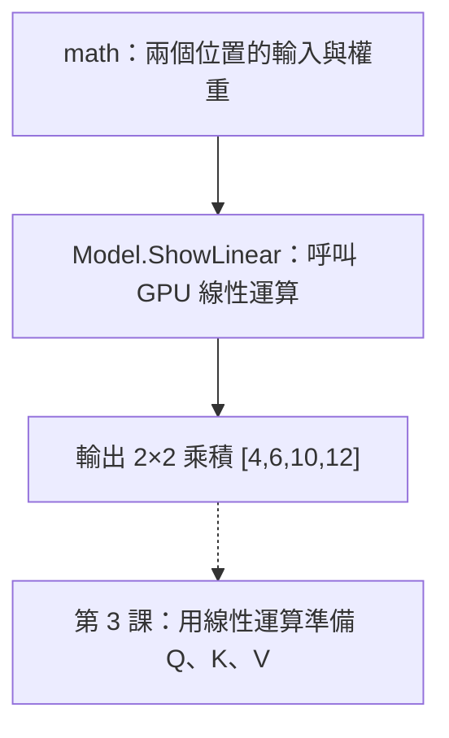
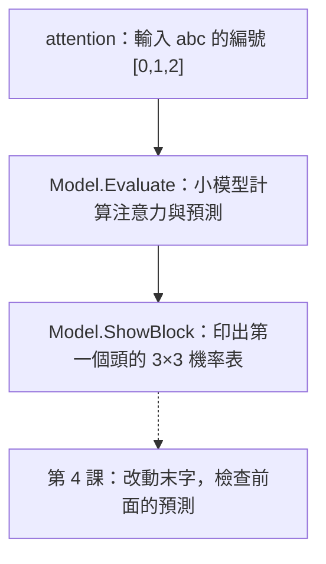
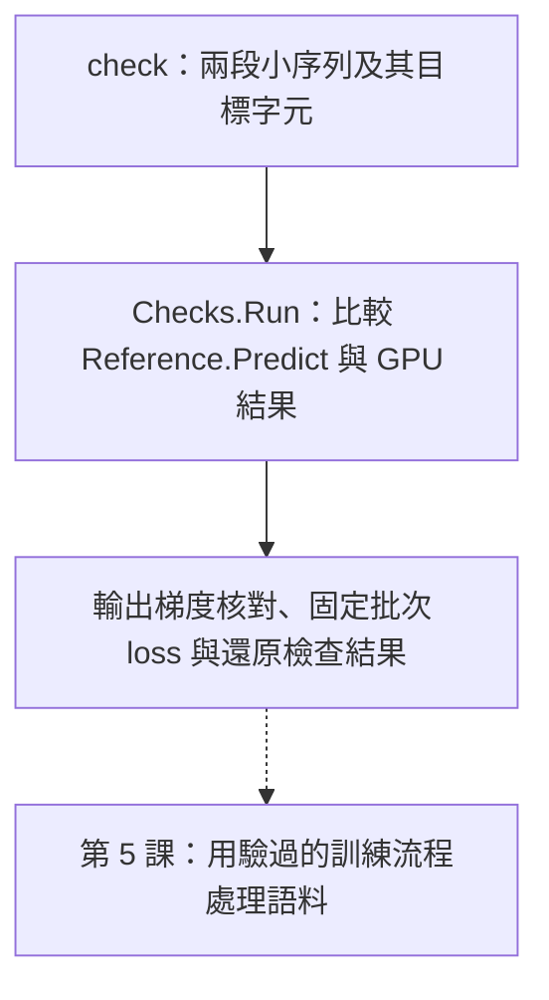
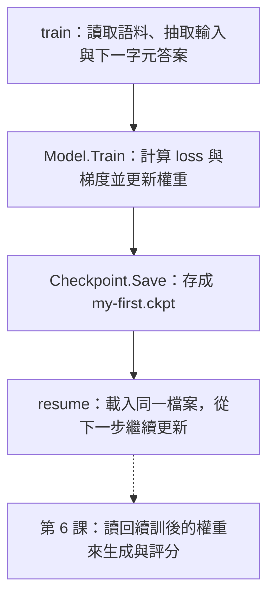
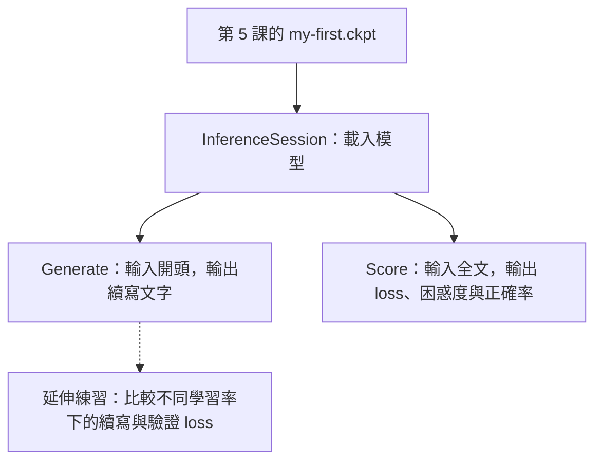

# 從矩陣乘法到可續訓的 my-gpt

[命令與推論函式圖解](../../docs/functions.zh-TW.md) · [模型與 GPU 函式圖解](../../docs/model-functions.zh-TW.md)。可先讀每課的小圖，再沿同名函式展開。my-gpt 模型計算候選字元分數，推論引擎負責載入、編碼、選字與反覆生成；兩者的配合見[專案總覽](../../README.zh-TW.md)。 [English](README.md)

在專案根目錄依序執行以下各課。硬體與 .NET 設定沿用[第 0 課](../00-cuda/README.zh-TW.md)。每一個指令都是一次獨立的程式執行。

命令範例都可由根目錄的 `my-gpt.cmd` 啟動。請整行貼上並按 Enter，數字參數後面保持空白或直接結束該行。模型路徑以目前工作目錄為準；第 6 課的範例需要先完成第 5 課，建立 `my-first.ckpt`。

第 0、1 課各有自己的小程式。從這裡開始，第 2 至 6 課共用同一套 GPT 實作。`math` 先單獨示範線性運算，`attention` 和 `check` 用較小的模型配置方便觀察與驗算；到了第 5 課才訓練並留下權重檔，供第 6 課載入。讀核心程式時，從 [Model.cs](Model.cs) 看一個字元如何通過 Transformer，再到 [Kernels.cs](Kernels.cs) 看每一步如何交給 GPU 計算。

[上一課：bigram](../01-learning/README.zh-TW.md) · [分數](#lesson-2) · [注意力](#lesson-3) · [驗算](#lesson-4) · [訓練](#lesson-5) · [推論](#lesson-6) · [專案總覽](../../README.zh-TW.md)

<a id="lesson-2"></a>

## 第 2 課　把分數算出來



上一課用目前字元查出一整列分數。這次改用一組數字表示每個位置，並用同一組權重替各位置計分。留意哪一列對應輸入位置、哪一欄對應候選字。

執行 `dotnet run --project lessons/my-gpt -- math`。假設兩個位置的輸入分別是 [1,2] 和 [3,4]，第一個候選字的權重是 [2,1]，第二個是 [0,3]。第一個位置給兩個候選字的分數就是 1×2+2×1=4、1×0+2×3=6。先自己算第二個位置，再對照 GPU 印出的四個分數 [4,6,10,12]。這個小程式先驗算矩陣乘法；當它用於模型輸出層、每欄對應一個字元時，分數就稱為 **logit**，數值可以大於 1。

回想上一課的 softmax。假如三個候選字的機率是 [0.1,0.6,0.3]，正解是第二個字，交叉熵就是 −ln(0.6) ≈ 0.511。若模型把正解的機率提高到 0.9，loss 會變為多少？手算可用 −ln(0.9) ≈ 0.105 核對。[GPU 算子](Kernels.cs) 的 Linear 算分數，Loss 用等價、數值較穩定的公式計算每個位置的 loss。

能從四個分數中指出「第二個位置、第一個候選字」的 10，並解釋為什麼正解機率越高、loss 越低，就掌握了輸出端。可是若每個位置只拿自己的數字去乘權重，同一個字碰到不同前文時，分數怎麼改變？

<a id="lesson-3"></a>

## 第 3 課　看見每個字可以讀到哪裡



這一課往輸出端的前一步看。因果注意力讓每個位置先讀取已出現的字，更新表示該位置的向量，隨後再使用上一課的線性運算來預測。

執行 `dotnet run --project lessons/my-gpt -- attention`。輸入是 abc，以 0、1、2 表示。每個字有一列 8 個數字，稱為嵌入向量。先將字元嵌入和位置嵌入相加，再從同一列算出三組向量：Q 表示這個位置要尋找的資訊，K 用來和 Q 算相似度，V 是可讀取的內容。

這個練習把 8 個數字拆給兩個頭，每個頭 4 個。用 Q 與各個 K 的內積除以 √4 得到分數，把未來位置排除後做 softmax，再依這些機率加權平均 V。程式會印出第一個頭的 3×3 機率表。列代表目前字，欄代表要讀取的字。第一列應是 [1,0,0]，第二列的 c 欄應為 0。找出第二列必定為零的位置，再檢查第三列的總和是否接近 1（輸出取到小數第三位）。

跟著 [Model 建構式](Model.cs) 讀一個 block。Norm 把每列數字調到相近尺度，Gain、Bias 讓模型學習合適的縮放與位移。Scores → Softmax → Mix 完成注意力；Add 把得到的新資訊加回原輸入。接著先擴寬每列、經過平滑的非線性函式 GELU，再縮回原寬並加回去。這條捷徑讓訊息與梯度都能穿過整個 block。最後 Linear 為每個位置產生字表大小的候選分數。[minGPT 的對照實作](https://github.com/karpathy/minGPT/blob/master/mingpt/model.py)

看著機率表，試著向同學解釋：預測 b 後面的字時，為什麼 b 可以參考 a，卻不能參考正解 c？下一課會真的改動 c，量測前面位置的輸出有沒有受到影響。

<a id="lesson-4"></a>

## 第 4 課　證明模型學得動



上一課讀的是一次前向計算。訓練還需要知道每一組權重該怎麼改，因此要把第 1 課的一個梯度，擴展到整個 Transformer 的參數。這次用小模型檢查梯度、未來字元的影響，以及更新後的結果。

執行 `dotnet run --project lessons/my-gpt -- check`。這一課用兩組各四個位置的小序列。先看 [CPU 參考答案](Reference.cs) 的二維陣列，再看 [數值檢查](Checks.cs) 怎麼用同一組權重比較 GPU 分數和 loss。

1. 前向計算依序產生分數與 loss。反向傳播沿相反順序，逐層算出「輸入稍微增加時，loss 會變多少」。同一個字出現兩次時，兩個位置都會對它的嵌入權重貢獻梯度。
2. 檢查器在每組參數選一個元素，先把權重加一點，再減一點。兩次 CPU loss 的差除以權重的差，是獨立的斜率估計，應接近 GPU 算出的梯度。
3. 改動第一段的末字，前面三個位置及另一段的分數都應相同。固定同一批資料更新 100 步，最後 loss 應低於起點的 35%。AdamW 用梯度的移動平均與平方的移動平均決定更新幅度，另外對指定權重施加衰減。
4. 存檔再讀回來，確認輸出逐項相同。兩個模型再各更新一步，比較所有權重，檢查動量是否也有正確還原。通過後最後一行是「checkpoint 還原 logits 及下一步更新一致」。

固定同一批資料的 loss 降低，說明模型可以學會這批例子。想知道它面對其他句子時表現如何，下一課會把語料切開，保留一段用作驗證。

<a id="lesson-5"></a>

## 第 5 課　訓練自己的模型、關掉程式、繼續生成



把上一課驗過的更新流程用在英文語料上。這次的產物是 checkpoint（權重與訓練狀態檔）；同一份檔案可以接著訓練，也可以只載入權重來續寫。

在專案根目錄使用一個新的檔名。以下指令共訓練 125 步。

```powershell
.\my-gpt.cmd train "lessons/my-gpt/my-first.ckpt" 100
.\my-gpt.cmd generate "lessons/my-gpt/my-first.ckpt" "the "
.\my-gpt.cmd resume "lessons/my-gpt/my-first.ckpt" 25
```

第一條指令配置 2 層、4 個頭、嵌入寬度 64 的模型。每步讀 1 段 64 字元，每個位置的答案是原文中的下一字。例如原文 abcd，輸入 abc，答案 bcd。GPU buffers 表示程式配置的張量空間，驅動程式還會使用其他顯存。暖機後的 tokens/s 是每秒處理多少個訓練位置。比較開頭與結尾的驗證 loss，再看模型能否續寫出語料裡的單字。教材語料由簡單英文句型組成，適合觀察模型學會拼字及句型的過程。

第二條指令重新讀取檔案，從開頭文字逐次挑分數最高的字；超過 64 個位置時只讀最近 64 個。這種選字法稱為貪婪解碼，同一個 checkpoint 與開頭會得到相同文字。試著把開頭換成 `"the fox "`，比較兩次續寫。第三條指令應印出 step 101 到 step 125 的進度。它會接著使用儲存的權重、AdamW 狀態、步數及資料順序。

自訂語料需先備妥。例如先把 UTF-8 純文字存成專案根目錄的 my-text.txt，執行 `Test-Path -LiteralPath "my-text.txt"` 應得到 True。接著可以把文字檔路徑放在步數後，例如 `dotnet run --project lessons/my-gpt -- train lessons/my-gpt/custom.ckpt 100 my-text.txt 4`，最後的 4 是每批段數。續訓時也要提供同一份文本，例如 `dotnet run --project lessons/my-gpt -- resume lessons/my-gpt/custom.ckpt 25 my-text.txt`。教材字表支援 2 至 1024 個單一 UTF-16 單元的字元，包含常見中文字；含 emoji 或擴展漢字等代理對的語料會在訓練前提示。資料依原順序切分，約前九成用來抽訓練視窗、後一成驗證。兩段各需至少 65 字元，驗證用字必須曾在訓練段出現。內建[語料](corpus.txt)保留未出現在訓練段的完整句子組合。

現在你可以用步數解釋訓練如何從上次中斷的地方繼續，也可以用驗證 loss 比較訓練前後的預測。接下來保留這份 checkpoint，看看固定權重時，如何從一段開頭逐字生成，以及如何替一段已有答案的文字評分。

<a id="lesson-6"></a>

## 第 6 課　載入一次模型，生成與評分



先在專案根目錄執行 `.\my-gpt.cmd chat lessons/my-gpt/my-first.ckpt`，載入上一課保存的模型並進入互動模式。輸入 `the fox ` 並按 Enter，模型逐字顯示新增內容，接著回到輸入提示。它會在同一個 session 中重複使用 GPU 權重。`/length 60` 可設定每次續寫 60 個字元，`/info` 顯示字表，`/exit` 結束程式。每次輸入是獨立的文字開頭。只有一個 checkpoint 時，也能直接執行 `.\my-gpt.cmd` 自動載入。

`InferenceSession` 負責載入權重、把文字轉成編號、呼叫 `Forward`、逐字挑選分數最高的候選字，並把結果還原成文字。你可以在同一個 session 依序傳入不同開頭。`Forward` 計算到候選分數就回傳。生成時使用 batch 1，載入既有訓練 checkpoint 時會略過動量，省下梯度與動量的 GPU 空間。續訓仍由 `resume` 載入完整狀態。

先用第 5 課儲存的模型執行。若仍在互動介面的「你>」提示，先輸入 `/exit` 回到 PowerShell，再執行下面的命令。第 5 課的 checkpoint 由你自行訓練建立，也可把下面路徑換成專案隨附的最佳教材權重： `lessons/my-gpt/quality-step1001-lr0.0003-22f75508d3.ckpt`。

```powershell
.\my-gpt.cmd generate "lessons/my-gpt/my-first.ckpt" "the fox " 60
.\my-gpt.cmd benchmark "lessons/my-gpt/my-first.ckpt" 100
.\my-gpt.cmd score "lessons/my-gpt/my-first.ckpt" "lessons/my-gpt/corpus.txt"
```

第一個指令新增 60 個字元。省略數量時預設為 100，設成 0 會直接回傳開頭。這份模型沒有句尾停止 token，所以輸出可能在字中間截斷。相同的模型、開頭和長度會得到相同的貪婪生成結果。輸入需在模型字表內。

第二個指令針對內建英文教材，用四個固定開頭比較模型，每個開頭各新增 100 個字元。它會列出 CUDA 裝置、模型步數、checkpoint SHA-256、載入耗時、推論緩衝區用量，再逐一列出生成文字、暖機後首字等待毫秒、生成字元／秒。這些時間在目前程序內量測，載入時間含模型初始化與 kernel 準備；生成速度和訓練速度的計算工作不同，應各自比較。至少需生成 1 個字元。

句型統計包含開頭，以句點分出完整句子，規則是 `the 動物 動作 in the 地點.`，動物、動作與地點各取自教材的四個字詞。同一個開頭的輸出中再次出現的相同句子會計入重複句。長度限制截斷的末句會排除。這個統計適合觀察本教材句型，應搭配閱讀生成文字。自訂語料的模型可以直接使用 `generate` 和 `score`。

第三個指令只讀取模型，對文本的每個下一字元評分。每 64 個位置重置一次上下文，最後不足 64 個位置也計入，因此長度為 n 的文本共有 n−1 個評分位置。它會回報平均交叉熵 loss、字元 perplexity（exp(loss)）和下一字元正確率。loss 和 perplexity 越低越好，正確率越高越好。文本至少需兩個字元，且所有字元都在訓練字表內。UTF-8 文本的換行會統一成 LF。

`corpus.txt` 包含訓練內容，適合確認指令運作、比較相同文本上的結果。評估泛化能力時，請在下一輪訓練前保留獨立測試集，訓練與調參完成後再對它評分。先前訓練的驗證 loss 只計完整視窗，`score` 會包含尾段，兩者評分位置可能不同。生成則使用最近 64 字元的滑動視窗。

[推論流程原始碼](InferenceSession.cs) 可搭配 [CLI 原始碼](InferenceCommands.cs) 閱讀。執行 `check` 也會用獨立 CPU 參考答案核對含尾段的評分，以及單段推論和原訓練模型的滑動視窗生成結果。

走完全程後，試著追蹤同一個字元分數的兩個用途：生成會從候選分數中挑選下一字，評分則查出原文中下一字的機率。接下來的筆電練習把兩者接回訓練，觀察學習率是否同時影響驗證 loss 和續寫文字。

[回看訓練流程](#lesson-5) · [返回專案總覽](../../README.zh-TW.md)

## 筆電實測

**練習：比較學習率。** 學習率控制每次更新權重的步幅。從同一個模型複製兩份，各跑相同步數，才能把差異歸因到步幅。以下以第 5 課建立的檔案為起點，請使用尚未存在的副本名稱：

請在同一個 PowerShell 視窗一次貼上整個區塊，依序設定變數、複製檔案及續訓：

```powershell
try {
    $source = (Resolve-Path -LiteralPath "lessons/my-gpt/my-first.ckpt" -ErrorAction Stop).Path
    $trial = Join-Path $PWD.Path "lessons/my-gpt/trial-small.ckpt"
    [IO.File]::Copy($source, $trial)
    .\my-gpt.cmd resume "$trial" 100 --lr 0.0003
} catch {
    Write-Error "副本建立失敗。請確認來源存在，並為副本使用尚未存在的檔名。"
}
```

另做一份副本，把學習率改成 0.003，再比較兩次的「訓練後驗證 loss」及同一句開頭的生成結果。`--lr` 只套用於本次指令，省略時使用預設值 0.003。要接著用較小步幅訓練，每次續訓都要指定相同的 `--lr`。

在 GTX 1650 Max-Q 4 GB 的一次實測中，固定預設語料與種子，每批 4 段訓練 500 步，驗證 loss 從 3.1469 降至 0.2053，暖機後約 32,849 tokens/s。模型明確配置了 12.18 MiB 緩衝區。另一次相同配置跑 300 步，以 nvidia-smi 取得 20 次整卡使用量，最高讀值為 63 MiB；取樣間隔內的瞬間用量可能更高。每批 1 段時，連跑 125 步與先跑 100 步、重新啟動後再跑 25 步的 checkpoint，SHA-256 相同。

## 對照四部影片

[神經網路與梯度](https://www.youtube.com/watch?v=SXnHqFGLNxA) 對應第 1 課的單權重。[預訓練](https://www.youtube.com/watch?v=EFXiQSxa4d8) 對應 bigram 與第 5 課的答案位移。[PyTorch 張量](https://www.youtube.com/watch?v=r1bquDz5GGA) 可和第 2、4 課的矩陣與梯度對讀。[Transformer](https://www.youtube.com/watch?v=CfJ3Cxtlcps) 對應第 3 課印出的注意力表及整個 block。
